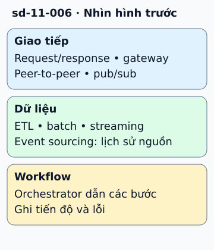

# Chín mẫu tổ chức luồng dữ liệu và giao tiếp

Ứng dụng đặt hàng có thể nhận HTTP đồng bộ, phát sự kiện cho kho và xử lý báo cáo ban đêm. Các luồng này giải quyết những nhu cầu khác nhau, không cần ép vào một mẫu duy nhất.

**Đọc hình:** Các khung tóm tắt vai trò hoặc lựa chọn để đối chiếu. Các con số và tình huống trong bài là ví dụ minh họa, trừ khi ghi rõ cách tính.

Request/response trao yêu cầu và kết quả. API gateway gom điểm vào; peer-to-peer cho các node trao đổi trực tiếp. Pub/sub phân phối sự kiện cho nhiều bên quan tâm. Orchestration để một bộ điều phối dẫn các bước công việc.

Ở lớp dữ liệu, ETL trích xuất, biến đổi rồi nạp; batching gom việc trước khi xử lý; streaming xử lý luồng liên tục. Event sourcing lưu các sự kiện nghiệp vụ làm lịch sử nguồn để dựng trạng thái.

Chọn theo việc bên gọi có cần kết quả ngay, ai sở hữu dữ liệu và hệ thống phải nhớ điều gì. Ví dụ, email xác nhận có thể đi qua pub/sub, nhưng kiểm tra đơn đã tồn tại cần đường đọc trạng thái rõ ràng.

## Nhìn hình thử trả lời

Một sự kiện đặt hàng cần đến cả email và phân tích. Chọn mẫu nào?

Xem đáp án

Pub/sub với các subscription riêng; nếu dùng một queue chung với competing consumers thì hai bên có thể chia việc thay vì mỗi bên nhận đủ sự kiện.

## Giới hạn cần nhớ

Đây là các mẫu ở nhiều tầng, có thể kết hợp. Dùng event broker không tự biến ứng dụng thành event sourcing.

Xem sâu hơn

Với luồng bất đồng bộ, xác định ordering, retry, deduplication và cách theo dõi trạng thái. Orchestrator cần lưu tiến độ để tiếp tục sau khi khởi động lại.

## Nguồn đối chiếu

- [Mục chủ đề ByteByteGo tại snapshot cố định](https://github.com/ByteByteGoHq/system-design-101/blob/b28380a4710c5ec9638ec037d4168e288f334cba/data/guides/top-9-architectural-patterns-for-data-and-communication-flow.md).
- [Publisher-Subscriber Pattern - Azure Architecture Center | Microsoft Learn](https://learn.microsoft.com/en-us/azure/architecture/patterns/publisher-subscriber).
- [Event Sourcing Pattern - Azure Architecture Center | Microsoft Learn](https://learn.microsoft.com/en-us/azure/architecture/patterns/event-sourcing).
- [Choreography Pattern - Azure Architecture Center | Microsoft Learn](https://learn.microsoft.com/en-us/azure/architecture/patterns/choreography).

Bài giải thích và hình được biên soạn độc lập; không dùng ảnh nguồn. Các tài liệu kỹ thuật trên là điểm đối chiếu cho review, không phải chứng nhận mọi claim đã được kiểm chứng.
