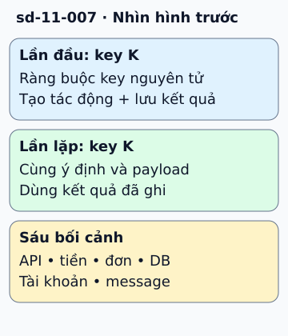

# Sáu nơi cần xử lý thao tác lặp an toàn

Khách bấm đặt hàng, server ghi đơn thành công nhưng phản hồi bị mất. Client gửi lại. Nếu mỗi lần gửi đều tạo đơn mới, một lỗi mạng biến thành hai đơn.

**Đọc hình:** Các khung tóm tắt vai trò hoặc lựa chọn để đối chiếu. Các con số và tình huống trong bài là ví dụ minh họa, trừ khi ghi rõ cách tính.

Idempotency nghĩa là lặp cùng thao tác không làm tăng thêm tác động mong muốn lên trạng thái. Cần ở API cập nhật, thanh toán, tạo đơn, ghi DB, quản lý tài khoản và consumer xử lý message. PUT cùng nội dung thường phù hợp; “tăng số dư thêm 100” cần một mã thao tác để nhận ra lần lặp.

Với thao tác tạo, client gửi idempotency key. Server gắn key với nội dung yêu cầu và kết quả, dùng ràng buộc duy nhất hoặc transaction để hai request đồng thời không cùng tạo tác động. Lần gửi lại lấy kết quả đã lưu. Khóa phải đại diện cho một ý định nghiệp vụ, không tái dùng cho đơn mới.

## Từ viết tắt

- **API** (Application Programming Interface) — giao diện lập trình ứng dụng: cách để một chương trình yêu cầu dữ liệu hoặc chức năng của chương trình khác; một trong sáu nơi cần xử lý thao tác lặp an toàn: gọi API lặp với cùng một khóa phải dùng kết quả đã ghi.
- **DB** (DataBase) — cơ sở dữ liệu: nơi lưu dữ liệu có tổ chức để ghi và tìm lại; nơi thứ hai là thao tác ghi vào DB.

## Nhìn hình thử trả lời

Hai request cùng key đến đồng thời. Tra cache rồi tạo đơn có đủ không?

Xem đáp án

Không. Cần cơ chế nguyên tử như unique constraint kết hợp transaction, và quy định trạng thái đang xử lý.

## Giới hạn cần nhớ

Idempotent nói về tác động, không bắt buộc các lần trả cùng status code. Chỉ kiểm tra key rồi ghi ở hai bước rời nhau vẫn có race condition.

Xem sâu hơn

Ghi phạm vi key theo người dùng/tenant, thời gian giữ và cách từ chối cùng key nhưng payload khác. Tác động ở dịch vụ ngoài cần cơ chế idempotency hoặc đối soát riêng.

## Nguồn đối chiếu

- [Mục chủ đề ByteByteGo tại snapshot cố định](https://github.com/ByteByteGoHq/system-design-101/blob/b28380a4710c5ec9638ec037d4168e288f334cba/data/guides/top-6-cases-to-apply-idempotency.md).
- [RFC 9110: HTTP Semantics](https://www.rfc-editor.org/rfc/rfc9110.html#section-9.2.2).
- [Idempotent requests | Stripe API Reference](https://docs.stripe.com/api/idempotent_requests).

Bài giải thích và hình được biên soạn độc lập; không dùng ảnh nguồn. Các tài liệu kỹ thuật trên là điểm đối chiếu cho review, không phải chứng nhận mọi claim đã được kiểm chứng.
