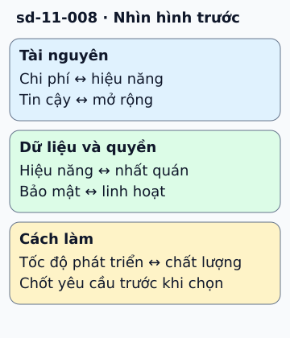

# Năm đánh đổi thường gặp trong thiết kế

Một ứng dụng bán vé cần trả nhanh, bán đúng số ghế và chịu được giờ mở bán. Một lựa chọn chỉ tốt khi biết mục tiêu nào bắt buộc và mục tiêu nào có thể điều chỉnh.

**Đọc hình:** Các khung tóm tắt vai trò hoặc lựa chọn để đối chiếu. Các con số và tình huống trong bài là ví dụ minh họa, trừ khi ghi rõ cách tính.

Chi phí với hiệu năng: tăng cache hoặc máy mạnh có thể nhanh hơn nhưng tốn hơn. Độ tin cậy với mở rộng: thêm bản sao, kiểm tra và điều phối có thể tăng chi phí xử lý. Hiệu năng với nhất quán: đọc replica nhanh gần người dùng có thể gặp dữ liệu cũ.

Bảo mật với linh hoạt: quyền chặt giảm thao tác tùy tiện nhưng cần quy trình cấp quyền tốt. Tốc độ phát triển với chất lượng: bỏ kiểm tra có thể ra bản đầu nhanh, rồi trả giá khi sửa lỗi.

Hãy ghi ràng buộc và cách đo. Với số ghế, tính đúng là điều kiện bắt buộc; có thể chấp nhận chờ thêm hoặc từ chối khi chưa xác nhận được dữ liệu.

## Nhìn hình thử trả lời

Có nên đọc tồn kho từ replica trễ để xác nhận bán ghế cuối cùng?

Xem đáp án

Không dùng dữ liệu cũ làm căn cứ duy nhất cho cam kết bán; cần thao tác kiểm tra và giữ ghế có tính nhất quán phù hợp.

## Giới hạn cần nhớ

Các cặp này không phải quy luật luôn đối nghịch. Cải thiện thuật toán hoặc loại bỏ việc thừa có thể vừa nhanh hơn vừa rẻ hơn; thiết kế vi phạm yêu cầu vẫn là thiết kế sai.

Xem sâu hơn

Tạo bảng quyết định gồm phương án, lợi ích, rủi ro và số đo cần kiểm. Ưu tiên cải thiện đo được, tránh chọn công nghệ chỉ vì tên phổ biến.

## Nguồn đối chiếu

- [Mục chủ đề ByteByteGo tại snapshot cố định](https://github.com/ByteByteGoHq/system-design-101/blob/b28380a4710c5ec9638ec037d4168e288f334cba/data/guides/top-5-trade-offs-in-system-designs.md).
- [AWS Well-Architected Framework - AWS Well-Architected Framework](https://docs.aws.amazon.com/wellarchitected/latest/framework/welcome.html).

Bài giải thích và hình được biên soạn độc lập; không dùng ảnh nguồn. Các tài liệu kỹ thuật trên là điểm đối chiếu cho review, không phải chứng nhận mọi claim đã được kiểm chứng.
