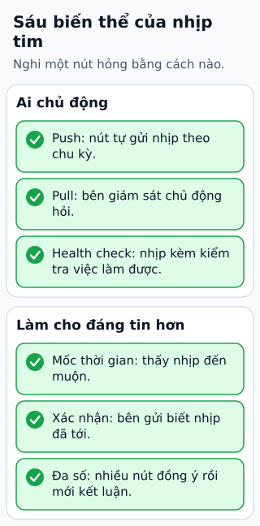

# Phát hiện node có thể đã hỏng bằng heartbeat

Node A gửi heartbeat cho B mỗi giây. B không thấy tín hiệu trong vài giây, nhưng có ít nhất ba khả năng: A chết, mạng chậm hoặc A đang tạm dừng. Quan sát này tạo nghi ngờ, chưa chứng minh nguyên nhân.

**Đọc hình:** Các khung tóm tắt vai trò hoặc lựa chọn để đối chiếu. Các con số và tình huống trong bài là ví dụ minh họa, trừ khi ghi rõ cách tính.

Push heartbeat để node chủ động báo; pull để bên giám sát hỏi. Có thể kèm health check để biết ứng dụng còn xử lý được, thêm số thứ tự hoặc thời gian để phát hiện tín hiệu cũ, và acknowledgement để kiểm tra trao đổi hai chiều. Trong cluster đồng thuận, liên lạc với đa số giúp quyết định có thể tiếp tục hoạt động nào.

Timeout ngắn phát hiện nhanh hơn nhưng dễ báo nhầm; timeout dài ít nhạy hơn nhưng chuyển dự phòng chậm. Dùng lịch sử độ trễ và phân biệt liveness với readiness: tiến trình còn sống chưa có nghĩa nó sẵn sàng phục vụ khách.

## Nhìn hình thử trả lời

Không nhận heartbeat có đủ để xóa dữ liệu của A không?

Xem đáp án

Không. Đó chỉ là tín hiệu nghi ngờ; cần quy trình xác minh, khôi phục và bảo vệ dữ liệu trước hành động phá hủy.

## Giới hạn cần nhớ

Heartbeat không tự ngăn split brain. Sau failover, cần quy tắc quyền ghi, quorum hoặc fencing để node cũ không tiếp tục gây tác động.

Xem sâu hơn

Đo khoảng thời gian bằng đồng hồ monotonic tại nơi nhận. Timestamp từ máy khác bị ảnh hưởng bởi lệch đồng hồ và không đủ để suy ra độ trễ mạng chính xác.

## Nguồn đối chiếu

- [Mục chủ đề ByteByteGo tại snapshot cố định](https://github.com/ByteByteGoHq/system-design-101/blob/b28380a4710c5ec9638ec037d4168e288f334cba/data/guides/how-do-we-detect-node-failures-in-distributed-systems.md).
- [raft.github.io — raft.pdf](https://raft.github.io/raft.pdf).
- [Configure Liveness, Readiness and Startup Probes | Kubernetes](https://kubernetes.io/docs/tasks/configure-pod-container/configure-liveness-readiness-startup-probes/).

Bài giải thích và hình được biên soạn độc lập; không dùng ảnh nguồn. Các tài liệu kỹ thuật trên là điểm đối chiếu cho review, không phải chứng nhận mọi claim đã được kiểm chứng.
