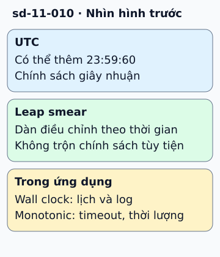

# Leap second và cách dùng đồng hồ an toàn

UTC đôi khi thêm giây nhuận để giữ gần thời gian quay của Trái Đất. Khi có giây nhuận dương, lịch có thể xuất hiện 23:59:60. Một thư viện chỉ chấp nhận giây từ 0 đến 59 dễ xử lý sai.

**Đọc hình:** Các khung tóm tắt vai trò hoặc lựa chọn để đối chiếu. Các con số và tình huống trong bài là ví dụ minh họa, trừ khi ghi rõ cách tính.

Một số hệ thống dùng leap smear: phân bổ điều chỉnh nhỏ trong một khoảng thời gian thay vì bước nhảy một giây. Chính sách smear khác nhau giữa nhà cung cấp; trộn nguồn thời gian có chính sách khác có thể tạo sai lệch giữa máy.

Ứng dụng cần hai cách nhìn thời gian. Wall clock phục vụ ngày giờ, lịch hẹn và log. Đồng hồ monotonic phục vụ đo khoảng chờ, timeout và thời lượng. Nếu wall clock được hiệu chỉnh ngược, một phép lấy giờ kết thúc trừ giờ bắt đầu có thể cho kết quả gây hiểu lầm. Chọn đúng đồng hồ tránh phụ thuộc vào việc giây nhuận được triển khai thế nào.

## Từ viết tắt

- **API** (Application Programming Interface) — giao diện lập trình ứng dụng: cách để một chương trình yêu cầu dữ liệu hoặc chức năng của chương trình khác; bài dặn dùng API monotonic cho khoảng thời gian, theo bảo đảm của nền tảng.
- **UTC** (Coordinated Universal Time) — giờ phối hợp quốc tế: mốc giờ chung không phụ thuộc múi giờ; UTC đôi khi thêm giây nhuận để giữ gần thời gian quay của Trái Đất.
- **GPS** (Global Positioning System) — hệ thống định vị toàn cầu bằng vệ tinh; giờ GPS là một thang thời gian riêng, không đồng nhất với UTC.
- **TAI** (Temps Atomique International) — thời gian nguyên tử quốc tế: thang giờ đếm đều theo đồng hồ nguyên tử, không có giây nhuận; bài dặn không coi TAI, giờ GPS và UTC là cùng một thang thời gian.

## Nhìn hình thử trả lời

Đo timeout bằng giờ lịch có rủi ro gì khi đồng hồ bị chỉnh?

Xem đáp án

Thời gian chờ có thể bị kéo dài hoặc rút ngắn ngoài dự kiến. Dùng API monotonic cho khoảng thời gian, theo bảo đảm của nền tảng.

## Giới hạn cần nhớ

Tiêu đề nguồn không có nghĩa các công ty đơn phương xóa leap second khỏi UTC. Không coi Unix time, TAI, GPS time và UTC là cùng thang thời gian.

Xem sâu hơn

Kiểm tra chính sách đồng bộ của toàn cluster. Timestamp hữu ích cho quan sát, nhưng thứ tự nhân quả giữa các node cần cơ chế khác như logical clock.

## Nguồn đối chiếu

- [Mục chủ đề ByteByteGo tại snapshot cố định](https://github.com/ByteByteGoHq/system-design-101/blob/b28380a4710c5ec9638ec037d4168e288f334cba/data/guides/do-you-know-why-meta-google-and-amazon-all-stop-using-leap-seconds.md).
- [Leap Smear | Public NTP | Google for Developers](https://developers.google.com/time/smear).
- [Precision clock and time synchronization on your EC2 instance - Amazon Elastic Compute Cloud](https://docs.aws.amazon.com/AWSEC2/latest/UserGuide/set-time.html).
- [time — Time access and conversions — Python 3.15.0 documentation](https://docs.python.org/3/library/time.html#time.monotonic).

Bài giải thích và hình được biên soạn độc lập; không dùng ảnh nguồn. Các tài liệu kỹ thuật trên là điểm đối chiếu cho review, không phải chứng nhận mọi claim đã được kiểm chứng.
