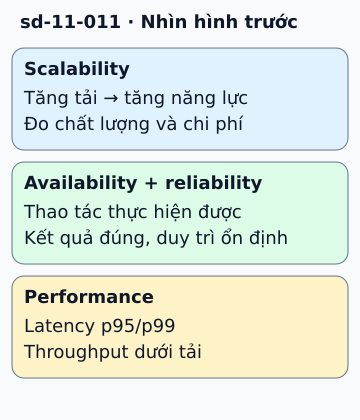

# Bốn trụ cột chất lượng hệ thống

Một dịch vụ đặt lịch đang chạy nhưng ghi nhầm giờ. Nó có thể sẵn sàng trả lời mà vẫn không đáng tin cậy. Bốn khái niệm chất lượng giúp tránh đánh giá cả hệ thống bằng một chỉ số.

**Đọc hình:** Các khung tóm tắt vai trò hoặc lựa chọn để đối chiếu. Các con số và tình huống trong bài là ví dụ minh họa, trừ khi ghi rõ cách tính.

Scalability: khi tải tăng, có thể tăng năng lực với chất lượng chấp nhận được không? Availability: người dùng có thực hiện được thao tác trong khoảng đo không? Reliability: hệ thống có duy trì hành vi đúng theo yêu cầu qua thời gian không? Performance: mỗi thao tác nhanh đến đâu và hoàn tất được bao nhiêu việc?

Ví dụ, thêm replica đọc có thể tăng khả năng phục vụ nhưng làm người dùng thấy lịch cũ. Thêm kiểm tra xung đột giúp kết quả đúng, nhưng cần đo độ trễ. Viết mục tiêu cho từng trụ: tỷ lệ thao tác tốt, số lịch ghi sai, p95/p99 và chi phí khi tải tăng. Các mục tiêu cụ thể giúp xác định cải tiến thật sự.

## Nhìn hình thử trả lời

API luôn trả trong 50 ms nhưng thỉnh thoảng mất lịch đã lưu. Trụ nào đang bị ảnh hưởng?

Xem đáp án

Reliability bị ảnh hưởng bởi mất kết quả đã cam kết. Latency tốt không bù được lỗi này.

## Giới hạn cần nhớ

Một phản hồi HTTP 200 không đủ chứng minh thao tác đúng. Cần định nghĩa thành công từ góc nhìn nghiệp vụ, không chỉ từ việc server còn sống.

Xem sâu hơn

SLI là chỉ số quan sát, SLO là mục tiêu của chỉ số. Đo tại biên người dùng và theo từng thao tác quan trọng, thay vì lấy trung bình tất cả endpoint.

## Nguồn đối chiếu

- [Mục chủ đề ByteByteGo tại snapshot cố định](https://github.com/ByteByteGoHq/system-design-101/blob/b28380a4710c5ec9638ec037d4168e288f334cba/data/guides/who-are-the-fantastic-four-of-system-design.md).
- [Google SRE - Defining slo: service level objective meaning](https://sre.google/sre-book/service-level-objectives/).
- [Reliability Pillar - AWS Well-Architected Framework - Reliability Pillar](https://docs.aws.amazon.com/wellarchitected/latest/reliability-pillar/welcome.html).

Bài giải thích và hình được biên soạn độc lập; không dùng ảnh nguồn. Các tài liệu kỹ thuật trên là điểm đối chiếu cho review, không phải chứng nhận mọi claim đã được kiểm chứng.
