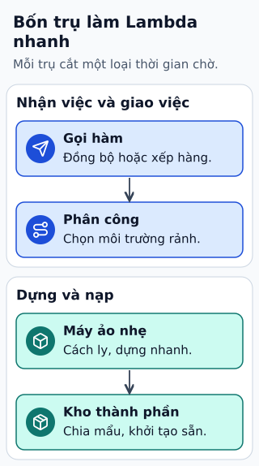

# Điều gì làm Lambda phản hồi nhanh hơn?

Hàm tính giá chạy nhanh trong phần handler nhưng lần gọi đầu vẫn chậm. Latency đầu cuối còn gồm định tuyến, khởi tạo runtime, tải mã và gọi các dịch vụ phụ thuộc.

**Đọc hình:** Các khung tóm tắt vai trò hoặc lựa chọn để đối chiếu. Các con số và tình huống trong bài là ví dụ minh họa, trừ khi ghi rõ cách tính.

Tái sử dụng execution environment có thể giảm phần khởi tạo. Firecracker hướng tới microVM nhẹ; đây là nền tảng cô lập, không bảo đảm một request cụ thể nhanh bao nhiêu. Provisioned Concurrency chuẩn bị môi trường cho concurrency đã cấu hình. SnapStart dùng snapshot đã khởi tạo ở runtime và cấu hình được hỗ trợ.

Ở mã ứng dụng, giảm dependency không dùng, tránh tải dữ liệu lớn khi khởi tạo, tái sử dụng kết nối khi an toàn và đo tác động của cấu hình memory. Không chỉ so thời gian handler: hãy xem cả cold start, timeout của API và độ trễ DB. Một Lambda đã “ấm” vẫn chậm nếu hệ thống phía sau quá tải.

## Nhìn hình thử trả lời

Handler mất 20 ms nhưng API mất 800 ms. Cần đo phần nào tiếp?

Xem đáp án

Đo init/cold start, các hop mạng, tích hợp API và lời gọi DB; thời gian handler chưa phải toàn bộ latency.

## Giới hạn cần nhớ

Provisioned Concurrency và SnapStart có điều kiện hỗ trợ, chi phí và giới hạn riêng. Không gán chi tiết Assignment Service hoặc cơ chế lưu mã nội bộ cho mọi Lambda hiện tại.

Xem sâu hơn

Với snapshot, dữ liệu ngẫu nhiên, thông tin xác thực hoặc kết nối tạo lúc init có thể cần làm mới sau restore. Kiểm tra tài liệu runtime trước khi bật.

## Nguồn đối chiếu

- [Mục chủ đề ByteByteGo tại snapshot cố định](https://github.com/ByteByteGoHq/system-design-101/blob/b28380a4710c5ec9638ec037d4168e288f334cba/data/guides/what-makes-aws-lambda-so-fast.md).
- [Understanding the Lambda execution environment lifecycle - AWS Lambda](https://docs.aws.amazon.com/lambda/latest/dg/lambda-runtime-environment.html).
- [Improving startup performance with Lambda SnapStart - AWS Lambda](https://docs.aws.amazon.com/lambda/latest/dg/snapstart.html).
- [Configuring provisioned concurrency for an Event Function - AWS Lambda](https://docs.aws.amazon.com/lambda/latest/dg/provisioned-concurrency.html).

Bài giải thích và hình được biên soạn độc lập; không dùng ảnh nguồn. Các tài liệu kỹ thuật trên là điểm đối chiếu cho review, không phải chứng nhận mọi claim đã được kiểm chứng.
