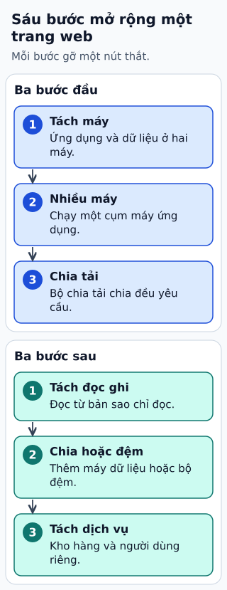

# Mở rộng website cho hàng triệu người dùng

“Một triệu người dùng” chưa cho biết có bao nhiêu request đồng thời. Một triệu tài khoản truy cập mỗi tháng khác hẳn một triệu người cùng mở bán vé. Ước lượng QPS, kích thước dữ liệu và tỷ lệ đọc/ghi trước.

**Đọc hình:** Các khung tóm tắt vai trò hoặc lựa chọn để đối chiếu. Các con số và tình huống trong bài là ví dụ minh họa, trừ khi ghi rõ cách tính.

Một lộ trình có thể bắt đầu từ ứng dụng và DB tách riêng. Khi ứng dụng đầy, chạy nhiều bản stateless sau load balancer. Khi ảnh và tài nguyên tĩnh chiếm băng thông, dùng object storage và CDN. Khi DB đọc quá nhiều, tối ưu truy vấn rồi cân nhắc cache và read replica.

Việc gửi mail hoặc dựng báo cáo có thể chuyển sang queue và worker. Sharding chỉ nên đến khi dữ liệu hoặc tải ghi cần chia thật sự. Tách microservice theo ranh giới nghiệp vụ khi có lợi ích triển khai hoặc sở hữu rõ ràng; số tài khoản lớn không tự tạo ra yêu cầu microservice.

## Từ viết tắt

- **QPS** (Queries Per Second) — số truy vấn mỗi giây: đo mức tải mà hệ thống phải xử lý; bài yêu cầu ước lượng QPS, kích thước dữ liệu và tỷ lệ đọc ghi trước.
- **LB** (Load Balancer) — bộ cân bằng tải: máy hoặc phần mềm chia lưu lượng cho nhiều bản sao của cùng một dịch vụ; trong hình, LB cùng ứng dụng không giữ trạng thái giúp chia tải phục vụ.
- **CDN** (Content Delivery Network) — mạng phân phối nội dung: nhiều máy chủ đặt ở nhiều nơi, lưu bản sao nội dung và phát cho người dùng từ máy gần họ; trong hình, CDN dùng cho nội dung tĩnh.
- **DB** (DataBase) — cơ sở dữ liệu: nơi lưu dữ liệu có tổ chức để ghi và tìm lại; theo điểm nghẽn của DB: chỉ mục, rồi bộ nhớ đệm hoặc bản sao đọc, rồi hàng đợi và chia dữ liệu khi cần.
- **RAM** (Random Access Memory) — bộ nhớ truy cập ngẫu nhiên: bộ nhớ làm việc của máy, đọc ghi nhanh nhưng mất sạch khi tắt điện; lưu session trong RAM của một máy làm việc mở rộng và chuyển sang máy khác khó hơn.

## Nhìn hình thử trả lời

Website nhiều tài khoản nhưng QPS thấp có cần sharding ngay không?

Xem đáp án

Không. Đo tải, dung lượng và truy vấn trước; thiết kế đơn giản có thể vẫn đáp ứng tốt.

## Giới hạn cần nhớ

Read replica chủ yếu chia tải đọc, không tự nhân năng lực ghi của primary. Session trong RAM một máy làm scale và failover khó hơn.

Xem sâu hơn

Thử tải với workload gần thực tế, có cache miss và lỗi phụ thuộc. Đo p99, pool kết nối, lag replica và tốc độ tiêu thụ queue trước khi mở thêm tầng.

## Nguồn đối chiếu

- [Mục chủ đề ByteByteGo tại snapshot cố định](https://github.com/ByteByteGoHq/system-design-101/blob/b28380a4710c5ec9638ec037d4168e288f334cba/data/guides/how-to-scale-a-website-to-support-millions-of-users.md).
- [AWS Well-Architected Framework - AWS Well-Architected Framework](https://docs.aws.amazon.com/wellarchitected/latest/framework/welcome.html).
- [Cache-Aside Pattern - Azure Architecture Center | Microsoft Learn](https://learn.microsoft.com/en-us/azure/architecture/patterns/cache-aside).
- [Competing Consumers Pattern - Azure Architecture Center | Microsoft Learn](https://learn.microsoft.com/en-us/azure/architecture/patterns/competing-consumers).

Bài giải thích và hình được biên soạn độc lập; không dùng ảnh nguồn. Các tài liệu kỹ thuật trên là điểm đối chiếu cho review, không phải chứng nhận mọi claim đã được kiểm chứng.
