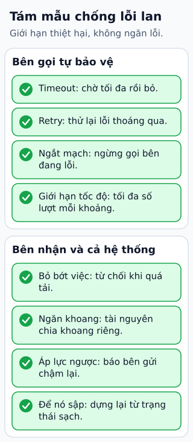

# Tám mẫu thiết kế giữ cho một lỗi nhỏ không thành sự cố lớn

**Sự cố lớn thường bắt đầu từ một lỗi nhỏ rồi lan theo kiểu quả cầu tuyết. Tám mẫu dưới đây không ngăn lỗi xảy ra; chúng giới hạn thiệt hại khi lỗi xảy ra.**
Mẫu nào cũng có chỗ dùng và chỗ hại, nên cần biết lý do, cách chạy và giới hạn trước khi áp dụng.

## Đọc hình

Tên tám mẫu giữ theo bài nguồn; lời giải thích và phép tính là của người biên soạn.

**Bên gọi tự bảo vệ**

- **Timeout (giới hạn thời gian chờ).** Chờ phản hồi tối đa một khoảng rồi bỏ. Không có nó, một lời gọi treo giữ tài nguyên mãi. Giới hạn: đặt ngắn quá thì bỏ cả những lời gọi vốn sắp xong; dài quá thì chẳng bảo vệ được gì.
- **Retry (thử lại).** Lỗi thoáng qua thì thử lại thường qua. Hay đi kèm giãn cách tăng dần và một chút ngẫu nhiên để các bên không cùng thử lại một lúc. Giới hạn: thử lại làm tăng tải đúng lúc bên kia đang yếu, và chỉ an toàn nếu thao tác idempotent (làm nhiều lần như một).
- **Circuit breaker (ngắt mạch).** Thấy bên kia lỗi liên tục thì ngừng gọi một lúc, như cầu dao tự ngắt, rồi thử lại từng chút. Giới hạn: phải chọn ngưỡng lỗi và thời gian nghỉ; chọn sai thì ngắt nhầm hoặc ngắt muộn.
- **Rate limiting (giới hạn tốc độ).** Cho mỗi bên gọi tối đa một số lượt trong một khoảng thời gian; vượt thì từ chối. Giới hạn: người dùng hợp lệ vẫn có thể bị từ chối khi chạm trần.

**Bên nhận và cả hệ thống tự bảo vệ**

- **Load shedding (bỏ bớt việc).** Quá tải thì chủ động từ chối một phần việc, thường việc ít quan trọng, để phần còn lại vẫn chạy tốt. Giới hạn: cần biết việc nào quan trọng, và người bị bỏ thấy lỗi.
- **Bulkhead (ngăn khoang).** Chia tài nguyên thành các khoang riêng, như vách ngăn của tàu, để một phần hỏng không làm chìm cả tàu. Giới hạn: tài nguyên bị chia nhỏ nên có khoang rảnh trong khi khoang khác thiếu.
- **Back pressure (áp lực ngược).** Bên nhận chậm thì báo ngược cho bên gửi chậm lại, thay vì để hàng đợi phình vô hạn. Giới hạn: bên gửi phải biết nghe tín hiệu, và có thể phải bỏ hoặc trì hoãn việc.
- **Let it crash (để nó sập).** Với lỗi không đoán trước, thà để thành phần dừng hẳn rồi một bộ giám sát dựng lại từ trạng thái sạch, còn hơn cố chạy tiếp ở trạng thái hỏng dở. Giới hạn: cần việc khởi động lại nhanh và không làm mất dữ liệu.

**Phép tính: thử lại khuếch đại tải thế nào.** Gọi bên kia, nếu lỗi thì thử lại tối đa 3 lần. Khi bên kia lỗi một nửa số lần, số lần gọi trung bình cho mỗi yêu cầu là 1 + 0,5 + 0,25 + 0,125 = 1,875. Khi bên kia hỏng hẳn, mỗi yêu cầu thành 4 lần gọi. Nếu bốn dịch vụ nối nhau A → B → C → D (ba bước gọi) và mỗi bước đều thử lại 3 lần, thì khi D hỏng hẳn, nó nhận tới 4 × 4 × 4 = 64 lần gọi cho mỗi yêu cầu ban đầu (với ba dịch vụ, hai bước gọi, con số là 4 × 4 = 16). Đó là lý do thử lại phải đi cùng ngắt mạch và giới hạn tổng số lần thử.

## Giới hạn cần nhớ

Các mẫu này hay dùng cùng nhau, và chúng có thể tác động qua lại: thử lại không ngắt mạch gây khuếch đại tải, ngắt mạch không có việc dự phòng làm người dùng thấy lỗi. Phép tính ở trên giả định mỗi lần gọi lỗi độc lập với xác suất như nhau và không có giãn cách; hệ thống thật khác. Bài không mô tả triển khai trong một thư viện hay nền tảng cụ thể và chưa đối chiếu được tài liệu chính thức nào trong phiên viết.

## Nhìn hình trả lời

Dịch vụ thanh toán chậm lại; dịch vụ đơn hàng gọi nó, mỗi lần gọi treo 30 giây và hết luồng xử lý, kéo cả trang đơn hàng sập. Hai mẫu nào giảm thiệt hại nhanh nhất, và nên thêm gì nữa?

Xem đáp án

Timeout ngắn để lời gọi không giữ luồng quá lâu, và circuit breaker để ngừng gọi dịch vụ đang yếu thay vì xếp thêm lời gọi treo. Thêm bulkhead để luồng gọi thanh toán nằm trong khoang riêng, nên dù thanh toán chậm, các phần khác của trang đơn hàng vẫn có luồng để chạy. Đây là suy luận của người biên soạn.

Xem sâu hơn: điều đã sắp xếp lại so với bài nguồn

Bài nguồn chỉ liệt kê tám tên và nói chúng thường dùng cùng nhau. Bài này giữ tên và thứ tự, chia thành hai nhóm theo bên tự bảo vệ, thêm cặp "lý do, giới hạn" cho mỗi mẫu và một phép tính về khuếch đại tải khi thử lại.

## Nguồn đối chiếu

- [ByteByteGo — bài nguồn tại commit cố định](https://github.com/ByteByteGoHq/system-design-101/blob/b28380a4710c5ec9638ec037d4168e288f334cba/data/guides/resiliency-patterns.md): chỉ lấy tên tám mẫu. Lời giải thích và phép tính là của người biên soạn.

Đã đọc nguồn ngày 2026-10-19. Bài viết và hình được thiết kế độc lập; phần giải thích là kiến thức chung của người biên soạn, chưa đối chiếu với tài liệu chính thức; phép tính là số học thuần túy.
