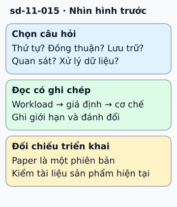

# Hai mươi lăm bài nghiên cứu để đọc có mục tiêu

Đọc paper dễ thành học tên hệ thống nếu chưa có câu hỏi. Hãy chọn vấn đề đang gặp: cần thứ tự sự kiện thì đọc Lamport; cần hiểu đồng thuận thì đọc Raft; cần hiểu sharding và replication thì chọn một bài về lưu trữ.

**Đọc hình:** Các khung tóm tắt vai trò hoặc lựa chọn để đối chiếu. Các con số và tình huống trong bài là ví dụ minh họa, trừ khi ghi rõ cách tính.

Mỗi lượt đọc nên ghi bốn điều: workload mà tác giả giải quyết, giả định về lỗi, cơ chế chính và đánh đổi. Với Raft, quan sát log, leader và majority; đừng chỉ nhớ rằng “có bầu leader”. Với Dapper, xem trace nối các lời gọi như thế nào và sampling ảnh hưởng quan sát ra sao.

Danh sách bên dưới giữ 25 tài liệu ở mục nguồn để tra cứu. Đây là lộ trình tham khảo, không phải thứ hạng ảnh hưởng đã được đo. Cơ chế của một sản phẩm hiện tại có thể khác phiên bản paper, vì thế dùng paper để hiểu lý do thiết kế rồi đọc tài liệu triển khai mới khi áp dụng.

## Nhìn hình thử trả lời

Bạn cần hiểu vì sao hai node có timestamp khác nhau vẫn chưa suy ra được quan hệ nhân quả. Nên bắt đầu ở đâu?

Xem đáp án

Bài Time, Clocks, and the Ordering of Events của Lamport; chú ý quan hệ happens-before và logical clock.

## Giới hạn cần nhớ

Chưa đọc đủ một paper thì không ghi là đã kiểm chứng cơ chế của nó. Bài này là bản đồ đọc; metadata không tuyên bố đã review 25 tài liệu.

Xem sâu hơn

Bốn hướng đọc: lưu trữ và đồng thuận; dữ liệu và ML; quan sát và vận hành; nền tảng lập trình. Với mỗi bài, ghi câu hỏi cần giải quyết trước khi mở PDF. Danh mục tài liệu:

1. [Dynamo - Amazon’s Highly Available Key Value Store](https://www.allthingsdistributed.com/files/amazon-dynamo-sosp2007.pdf)
2. [Google File System](https://static.googleusercontent.com/media/research.google.com/en//archive/gfs-sosp2003.pdf)
3. [Scaling Memcached at Facebook](https://research.facebook.com/file/839620310074473/scaling-memcache-at-facebook.pdf)
4. [BigTable](https://static.googleusercontent.com/media/research.google.com/en//archive/bigtable-osdi06.pdf)
5. [Borg - Large Scale Cluster Management at Google](https://storage.googleapis.com/pub-tools-public-publication-data/pdf/43438.pdf)
6. [Cassandra](https://www.cs.cornell.edu/projects/ladis2009/papers/lakshman-ladis2009.pdf)
7. [Attention Is All You Need](https://arxiv.org/abs/1706.03762)
8. [Kafka](https://www.microsoft.com/en-us/research/wp-content/uploads/2017/09/Kafka.pdf)
9. [FoundationDB](https://www.foundationdb.org/files/fdb-paper.pdf)
10. [Amazon Aurora](https://web.stanford.edu/class/cs245/readings/aurora.pdf)
11. [Spanner](https://static.googleusercontent.com/media/research.google.com/en//archive/spanner-osdi2012.pdf)
12. [MapReduce](https://storage.googleapis.com/pub-tools-public-publication-data/pdf/16cb30b4b92fd4989b8619a61752a2387c6dd474.pdf)
13. [Shard Manager](https://dl.acm.org/doi/pdf/10.1145/3477132.3483546)
14. [Dapper](https://static.googleusercontent.com/media/research.google.com/en//archive/papers/dapper-2010-1.pdf)
15. [Flink](https://www.researchgate.net/publication/308993790_Apache_Flink_Stream_and_Batch_Processing_in_a_Single_Engine)
16. [A Comprehensive Survey on Vector Databases](https://arxiv.org/pdf/2310.11703.pdf)
17. [Zanzibar](https://storage.googleapis.com/pub-tools-public-publication-data/pdf/10683a8987dbf0c6d4edcafb9b4f05cc9de5974a.pdf)
18. [Monarch](https://storage.googleapis.com/pub-tools-public-publication-data/pdf/d84ab6c93881af998de877d0070a706de7bec6d8.pdf)
19. [Thrift](https://thrift.apache.org/static/files/thrift-20070401.pdf)
20. [Bitcoin](https://bitcoin.org/bitcoin.pdf)
21. [WTF - Who to Follow Service at Twitter](https://web.stanford.edu/~rezab/papers/wtf_overview.pdf)
22. [MyRocks: LSM-Tree Database Storage Engine](https://www.vldb.org/pvldb/vol13/p3217-matsunobu.pdf)
23. [GoTo Considered Harmful](https://homepages.cwi.nl/~storm/teaching/reader/Dijkstra68.pdf)
24. [Raft Consensus Algorithm](https://raft.github.io/raft.pdf)
25. [Time Clocks and Ordering of Events](https://lamport.azurewebsites.net/pubs/time-clocks.pdf)

## Nguồn đối chiếu

- [Mục chủ đề ByteByteGo tại snapshot cố định](https://github.com/ByteByteGoHq/system-design-101/blob/b28380a4710c5ec9638ec037d4168e288f334cba/data/guides/25-papers-that-completely-transformed-the-computer-world.md).
- [lamport.azurewebsites.net — time-clocks.pdf](https://lamport.azurewebsites.net/pubs/time-clocks.pdf).
- [raft.github.io — raft.pdf](https://raft.github.io/raft.pdf).

Bài giải thích và hình được biên soạn độc lập; không dùng ảnh nguồn. Các tài liệu kỹ thuật trên là điểm đối chiếu cho review, không phải chứng nhận mọi claim đã được kiểm chứng.
