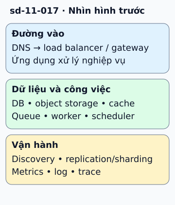

# Các khối xây dựng của hệ thống

Một website lưu ảnh cần nhiều vai trò, nhưng không cần mọi sản phẩm cloud. DNS giúp tìm địa chỉ; load balancer phân phối request; gateway xử lý điểm vào. Ứng dụng đọc dữ liệu có cấu trúc trong DB, còn file ảnh đặt ở object storage.

**Đọc hình:** Các khung tóm tắt vai trò hoặc lựa chọn để đối chiếu. Các con số và tình huống trong bài là ví dụ minh họa, trừ khi ghi rõ cách tính.

Cache giữ bản dữ liệu có thể lấy lại; queue mang công việc sang worker; scheduler quyết định lúc chạy. Service discovery giúp tìm instance khi địa chỉ thay đổi. CDN đưa nội dung tới gần người đọc. Replication tạo bản sao, sharding chia tập dữ liệu, consistent hashing hỗ trợ phân phối khóa khi nhóm node đổi.

Cuối cùng cần metrics, log và trace để biết việc nào lỗi ở đâu. Hãy mô tả trách nhiệm trước rồi mới chọn sản phẩm. Nếu một hộp không giải quyết nhu cầu cụ thể, bỏ nó khỏi bản đầu. Ít thành phần hơn thường giúp dễ thử và dễ vận hành hơn.

## Từ viết tắt

- **DNS** (Domain Name System) — hệ thống tên miền: "danh bạ" của Internet, đổi tên miền thành địa chỉ mạng để biết tìm dịch vụ ở đâu; DNS giúp tìm địa chỉ của website.
- **CDN** (Content Delivery Network) — mạng phân phối nội dung: nhiều máy chủ đặt ở nhiều nơi, lưu bản sao nội dung và phát cho người dùng từ máy gần họ; CDN đưa nội dung tới gần người đọc.
- **DB** (DataBase) — cơ sở dữ liệu: nơi lưu dữ liệu có tổ chức để ghi và tìm lại; ứng dụng đọc dữ liệu có cấu trúc trong DB, còn file ảnh đặt ở object storage.

## Nhìn hình thử trả lời

Ảnh gốc không thể tái tạo. Có nên chỉ lưu trong cache không?

Xem đáp án

Không. Lưu ở kho bền như object storage; cache chỉ tăng tốc truy cập bản có thể phục hồi.

## Giới hạn cần nhớ

Cache không thay kho lưu bền; queue không tự giải quyết idempotency. DB có thể lưu nhiều kiểu dữ liệu, không chỉ bảng quan hệ.

Xem sâu hơn

Với mỗi khối, ghi chủ sở hữu, dữ liệu giữ, bảo đảm lỗi và chỉ số theo dõi. Điều này có giá trị hơn danh sách logo nhà cung cấp.

## Nguồn đối chiếu

- [Mục chủ đề ByteByteGo tại snapshot cố định](https://github.com/ByteByteGoHq/system-design-101/blob/b28380a4710c5ec9638ec037d4168e288f334cba/data/guides/must-know-system-design-building-blocks.md).
- [AWS Well-Architected Framework - AWS Well-Architected Framework](https://docs.aws.amazon.com/wellarchitected/latest/framework/welcome.html).
- [Cache-Aside Pattern - Azure Architecture Center | Microsoft Learn](https://learn.microsoft.com/en-us/azure/architecture/patterns/cache-aside).
- [Competing Consumers Pattern - Azure Architecture Center | Microsoft Learn](https://learn.microsoft.com/en-us/azure/architecture/patterns/competing-consumers).

Bài giải thích và hình được biên soạn độc lập; không dùng ảnh nguồn. Các tài liệu kỹ thuật trên là điểm đối chiếu cho review, không phải chứng nhận mọi claim đã được kiểm chứng.
