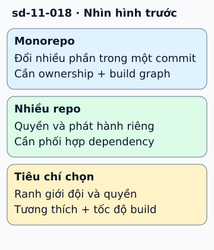

# Monorepo hay nhiều repo nhỏ?

Đội web và API cùng sửa một kiểu dữ liệu. Trong monorepo, họ có thể đổi mã ở nhiều thư mục trong một commit. Trong nhiều repo, mỗi bên có lịch phát hành riêng và cần cách phối hợp phiên bản giao diện.

**Đọc hình:** Các khung tóm tắt vai trò hoặc lựa chọn để đối chiếu. Các con số và tình huống trong bài là ví dụ minh họa, trừ khi ghi rõ cách tính.

Monorepo thuận tiện cho refactor xuyên dự án, tìm mã và chia sẻ tooling. Đổi lại, cần build chọn đúng phần bị ảnh hưởng, quy tắc ownership và kiểm soát truy cập phù hợp. Nhiều repo làm ranh giới quyền và vòng đời phát hành rõ hơn, nhưng cập nhật dependency chung dễ thành công việc lặp và phiên bản lệch nhau.

Chọn theo cách đội làm việc, không theo số microservice. Một monorepo vẫn có thể triển khai nhiều dịch vụ độc lập; nhiều repo vẫn có thể cùng tạo một ứng dụng. Dù chọn cách nào, cần contract test và kế hoạch tương thích khi bên cung cấp và bên dùng chưa nâng cấp cùng lúc.

## Từ viết tắt

- **API** (Application Programming Interface) — giao diện lập trình ứng dụng: cách để một chương trình yêu cầu dữ liệu hoặc chức năng của chương trình khác; đội web và API cùng sửa một kiểu dữ liệu: trong monorepo, họ có thể đổi mã ở nhiều thư mục trong một commit.

## Nhìn hình thử trả lời

Có mười microservice thì bắt buộc có mười repo không?

Xem đáp án

Không. Ranh giới triển khai và ranh giới repo là hai lựa chọn riêng; dựa vào quyền, tooling và nhu cầu phối hợp.

## Giới hạn cần nhớ

Cùng repo không bắt buộc cùng phiên bản mọi dependency. Tách repo cũng không tự tạo ownership tốt hoặc tốc độ build nhanh.

Xem sâu hơn

Build graph và cache giúp tránh build lại mọi mục trong monorepo. Với nhiều repo, dùng package version và chính sách nâng cấp có kiểm soát.

## Nguồn đối chiếu

- [Mục chủ đề ByteByteGo tại snapshot cố định](https://github.com/ByteByteGoHq/system-design-101/blob/b28380a4710c5ec9638ec037d4168e288f334cba/data/guides/monorepo-vs.md).
- [Dependency Management - Bazel Documentation](https://bazel.build/basics/dependencies).
- [About code owners - GitHub Docs](https://docs.github.com/en/repositories/managing-your-repositorys-settings-and-features/customizing-your-repository/about-code-owners).

Bài giải thích và hình được biên soạn độc lập; không dùng ảnh nguồn. Các tài liệu kỹ thuật trên là điểm đối chiếu cho review, không phải chứng nhận mọi claim đã được kiểm chứng.
