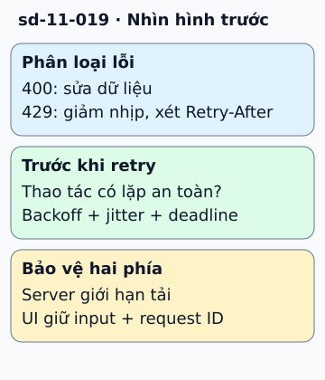

# Xử lý lỗi web request mà không làm quá tải thêm

Client gửi lưu hồ sơ rồi gặp timeout. Request có thể chưa tới server, hoặc đã ghi thành công nhưng phản hồi bị mất. Cần xác định khả năng lặp an toàn trước khi thử lại.

**Đọc hình:** Các khung tóm tắt vai trò hoặc lựa chọn để đối chiếu. Các con số và tình huống trong bài là ví dụ minh họa, trừ khi ghi rõ cách tính.

Với lỗi đầu vào như 400, sửa dữ liệu thay vì lặp y nguyên. Với 401, xử lý thông tin xác thực theo giao thức. Với 429, giảm nhịp và tôn trọng Retry-After nếu có. Với lỗi mạng hoặc một số 5xx tạm thời, có thể retry trong ngân sách chờ, dùng backoff và jitter. Không phải mọi 4xx đều cấm retry, và không phải mọi 5xx đều đáng retry.

Server nên trả mã lỗi và thông điệp có thể hành động, kèm request ID để tra log. Rate limiter và circuit breaker bảo vệ tài nguyên khi tải hoặc lỗi tăng. UI giữ dữ liệu người dùng đã nhập và nói rõ trạng thái chưa xác định thay vì khẳng định thao tác thất bại.

## Từ viết tắt

- **UI** (User Interface) — giao diện người dùng: phần người dùng nhìn thấy và thao tác; trong hình, UI giữ input của người dùng khi gặp lỗi.
- **ID** (IDentifier) — mã định danh: chuỗi hoặc số dùng để phân biệt một đối tượng với các đối tượng khác; server nên trả kèm request ID để tra log.

## Nhìn hình thử trả lời

Nhận 429 kèm Retry-After: 10 thì client nên làm gì?

Xem đáp án

Chờ theo hướng dẫn và giảm nhịp, nếu còn ngân sách và thao tác lặp an toàn; không gửi lại ngay.

## Giới hạn cần nhớ

Không retry thao tác ghi không idempotent chỉ vì nó trả 500. Lỗi sau commit vẫn có thể tạo tác động; cần key, tra trạng thái hoặc đối soát.

Xem sâu hơn

Phân biệt deadline của người dùng với số lần retry. Khi deadline hết, dừng và cho cách xem trạng thái thay vì tiếp tục gửi nền không kiểm soát.

## Nguồn đối chiếu

- [Mục chủ đề ByteByteGo tại snapshot cố định](https://github.com/ByteByteGoHq/system-design-101/blob/b28380a4710c5ec9638ec037d4168e288f334cba/data/guides/how-to-handle-web-request-error.md).
- [RFC 9110: HTTP Semantics](https://www.rfc-editor.org/rfc/rfc9110.html).
- [www.rfc-editor.org — rfc6585.html](https://www.rfc-editor.org/rfc/rfc6585.html#section-4).
- [Timeouts, retries, and backoff with jitter | AWS Builder Center](https://aws.amazon.com/builders-library/timeouts-retries-and-backoff-with-jitter/).

Bài giải thích và hình được biên soạn độc lập; không dùng ảnh nguồn. Các tài liệu kỹ thuật trên là điểm đối chiếu cho review, không phải chứng nhận mọi claim đã được kiểm chứng.
