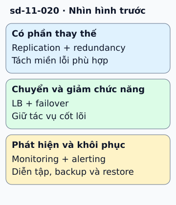

# Checklist thiết kế chịu lỗi

Nếu một instance mất điện, website có tiếp tục bán hàng không? Câu trả lời phụ thuộc cả đường request và dữ liệu, không chỉ số instance.

**Đọc hình:** Các khung tóm tắt vai trò hoặc lựa chọn để đối chiếu. Các con số và tình huống trong bài là ví dụ minh họa, trừ khi ghi rõ cách tính.

Replication duy trì bản sao dữ liệu; redundancy cung cấp thành phần thay thế. Load balancer đưa request tới backend đủ điều kiện phục vụ. Failover chuyển quyền phục vụ khi primary không còn hoạt động. Graceful degradation giữ phần cốt lõi khi tính năng phụ hỏng. Monitoring và alerting cho biết người dùng đang gặp lỗi để đội vận hành hành động.

Ví dụ, khi hệ gợi ý hỏng, trang sản phẩm vẫn có thể hiển thị thông tin và giá. Nhưng nếu kho dữ liệu thanh toán không xác nhận được, không được giả vờ đã thu tiền. Hãy đi từng phụ thuộc, ghi tác động khi nó hỏng, cơ chế phát hiện và cách khôi phục. Diễn tập giúp tìm thành phần dùng chung mà sơ đồ dự phòng đã bỏ sót.

## Từ viết tắt

- **DB** (DataBase) — cơ sở dữ liệu: nơi lưu dữ liệu có tổ chức để ghi và tìm lại; ví dụ trong bài: hai máy ứng dụng dùng chung một DB duy nhất vẫn còn điểm lỗi đơn.
- **LB** (Load Balancer) — bộ cân bằng tải: máy hoặc phần mềm chia lưu lượng cho nhiều bản sao của cùng một dịch vụ; trong hình, LB cùng failover thuộc nhóm chuyển và giảm chức năng.

## Nhìn hình thử trả lời

Hai app server dùng cùng một DB duy nhất. Đã loại hết điểm lỗi đơn chưa?

Xem đáp án

Chưa. DB và các phụ thuộc chung vẫn có thể làm cả hai server ngừng phục vụ.

## Giới hạn cần nhớ

Load balancer cũng cần độ sẵn sàng phù hợp. Nhiều replica cùng dùng một nguồn điện, cấu hình lỗi hoặc dependency vẫn có thể hỏng cùng lúc.

Xem sâu hơn

Thử lỗi có kiểm soát: dừng node, làm chậm phụ thuộc và kiểm tra restore. Giảm chức năng phải có thông báo và tiêu chí kết thúc rõ ràng.

## Nguồn đối chiếu

- [Mục chủ đề ByteByteGo tại snapshot cố định](https://github.com/ByteByteGoHq/system-design-101/blob/b28380a4710c5ec9638ec037d4168e288f334cba/data/guides/a-cheat-sheet-for-designing-fault-tolerant-systems.md).
- [Reliability Pillar - AWS Well-Architected Framework - Reliability Pillar](https://docs.aws.amazon.com/wellarchitected/latest/reliability-pillar/welcome.html).
- [Health Endpoint Monitoring Pattern - Azure Architecture Center | Microsoft Learn](https://learn.microsoft.com/en-us/azure/architecture/patterns/health-endpoint-monitoring).

Bài giải thích và hình được biên soạn độc lập; không dùng ảnh nguồn. Các tài liệu kỹ thuật trên là điểm đối chiếu cho review, không phải chứng nhận mọi claim đã được kiểm chứng.
