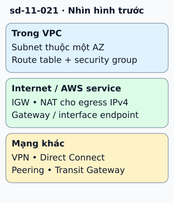

# Mạng AWS điển hình: chọn đường kết nối đúng

Trong một Region, VPC chứa các subnet gắn với từng Availability Zone. Một thiết kế web có thể đặt load balancer ở subnet public, ứng dụng và DB ở subnet private. Route table quyết định đường đi; security group giới hạn lưu lượng được phép.

**Đọc hình:** Các khung tóm tắt vai trò hoặc lựa chọn để đối chiếu. Các con số và tình huống trong bài là ví dụ minh họa, trừ khi ghi rõ cách tính.

Internet Gateway hỗ trợ đường ra/vào internet cho tài nguyên đáp ứng điều kiện định tuyến và địa chỉ. Với IPv4, ứng dụng private có thể đi ra qua NAT Gateway mà không mở đường khởi tạo kết nối trực tiếp từ internet. Gateway endpoint phục vụ S3/DynamoDB; interface endpoint dùng PrivateLink cho dịch vụ được hỗ trợ.

Để nhân viên truy cập, cân nhắc Client VPN. Kết nối mạng công ty có Site-to-Site VPN hoặc Direct Connect. VPC peering nối các VPC theo cặp; Transit Gateway đóng vai trò hub khi có nhiều mạng. Mỗi đường cần cấu hình route, quyền và DNS thích hợp.

## Nhìn hình thử trả lời

App private cần đọc S3. Có bắt buộc qua NAT không?

Xem đáp án

Không. Có thể dùng S3 gateway endpoint với route và policy đúng, tùy nhu cầu truy cập.

## Giới hạn cần nhớ

Subnet “public” không làm mọi instance tự có internet. Peering không tự cho định tuyến bắc cầu; gateway endpoint không phải interface endpoint.

Xem sâu hơn

Triển khai nhiều AZ phải xét cả subnet, load balancer và đường egress. Đặt route qua NAT ở AZ khác có thể thêm chi phí và phụ thuộc vào AZ đó.

## Nguồn đối chiếu

- [Mục chủ đề ByteByteGo tại snapshot cố định](https://github.com/ByteByteGoHq/system-design-101/blob/b28380a4710c5ec9638ec037d4168e288f334cba/data/guides/typical-aws-network-architecture-in-one-diagram.md).
- [What is Amazon VPC? - Amazon Virtual Private Cloud](https://docs.aws.amazon.com/vpc/latest/userguide/what-is-amazon-vpc.html).
- [Gateway endpoints - Amazon Virtual Private Cloud](https://docs.aws.amazon.com/vpc/latest/privatelink/gateway-endpoints.html).
- [How VPC peering connections work - Amazon Virtual Private Cloud](https://docs.aws.amazon.com/vpc/latest/peering/invalid-peering-configurations.html).

Bài giải thích và hình được biên soạn độc lập; không dùng ảnh nguồn. Các tài liệu kỹ thuật trên là điểm đối chiếu cho review, không phải chứng nhận mọi claim đã được kiểm chứng.
