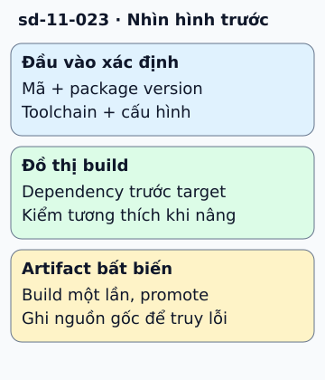

# Brazil: bài học về build tái lập và dependency

Ứng dụng dùng thư viện A, còn A dùng B. Nếu mỗi lần build tự lấy phiên bản mới nhất, cùng commit ứng dụng có thể tạo kết quả khác nhau. Bài học cốt lõi của build tái lập là kiểm soát toàn bộ đầu vào.

**Đọc hình:** Các khung tóm tắt vai trò hoặc lựa chọn để đối chiếu. Các con số và tình huống trong bài là ví dụ minh họa, trừ khi ghi rõ cách tính.

Brazil là hệ build nội bộ Amazon, thường được mô tả cùng khái niệm version set: tập phiên bản package tương thích để build một nhóm phần mềm. Đồ thị dependency cho biết phải dựng thành phần nào trước. Khi nâng một package, cần kiểm tra các thành phần bị ảnh hưởng trước khi đưa bộ phiên bản mới vào dùng.

Ở repo thông thường, có thể học nguyên tắc này bằng lockfile, toolchain ghim phiên bản, môi trường build xác định và artifact có định danh bất biến. CI tạo artifact một lần; các môi trường triển khai dùng cùng artifact đó. Như vậy, lỗi ở production có thể truy về mã và đầu vào đã tạo ra nó.

## Nhìn hình thử trả lời

Cùng commit nhưng lần build sau dùng compiler khác. Có thể coi đầu vào giống nhau không?

Xem đáp án

Không. Toolchain là đầu vào build; cần ghim và ghi lại cùng dependency, cấu hình và môi trường.

## Giới hạn cần nhớ

Brazil là hệ nội bộ, không có hướng dẫn cài công khai tương đương một sản phẩm OSS. Bài này không khẳng định sơ đồ hay tính năng nội bộ hiện tại của Amazon.

Xem sâu hơn

Tái lập bit-for-bit còn cần xử lý timestamp, đường dẫn và nguồn nondeterminism. Ghim dependency là cần thiết nhưng chưa đủ cho mọi pipeline.

## Nguồn đối chiếu

- [Mục chủ đề ByteByteGo tại snapshot cố định](https://github.com/ByteByteGoHq/system-design-101/blob/b28380a4710c5ec9638ec037d4168e288f334cba/data/guides/how-does-amazon-build-system-work.md).
- [Definitions — reproducible-builds.org](https://reproducible-builds.org/docs/definition/).
- [Dependency Management - Bazel Documentation](https://bazel.build/basics/dependencies).

Bài giải thích và hình được biên soạn độc lập; không dùng ảnh nguồn. Các tài liệu kỹ thuật trên là điểm đối chiếu cho review, không phải chứng nhận mọi claim đã được kiểm chứng.
