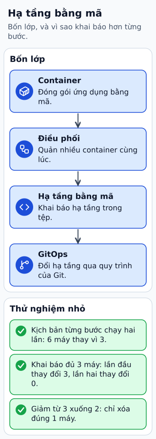

# Bản đồ công cụ Infrastructure as Code

Đội tạo môi trường thử nghiệm bằng vài thao tác console. Đến lần thứ ba, firewall khác lần đầu và không ai nhớ đã đổi gì. Infrastructure as Code đưa định nghĩa hạ tầng vào tệp có version để có thể xem diff, kiểm tra và lặp lại.

**Đọc hình:** Các khung tóm tắt vai trò hoặc lựa chọn để đối chiếu. Các con số và tình huống trong bài là ví dụ minh họa, trừ khi ghi rõ cách tính.

Terraform, CloudFormation và Pulumi thường dùng cho provisioning. Ansible, Chef hoặc Puppet thường quản lý cấu hình máy và phần mềm, dù phạm vi công cụ có thể giao nhau. Docker đóng gói ứng dụng; Kubernetes điều phối workload. GitOps thêm cơ chế đối chiếu trạng thái mong muốn trong Git với trạng thái đang chạy.

Một luồng làm việc là: thay đổi định nghĩa, xem plan hoặc change set, review, apply và kiểm tra kết quả. Cần quản lý state khi công cụ dùng state, quyền thực thi và drift do thay đổi ngoài luồng. Chọn công cụ dựa vào tài nguyên, đội vận hành và cách khôi phục khi apply dở dang.

## Nhìn hình thử trả lời

Kubernetes manifest có thay được toàn bộ provisioning cloud không?

Xem đáp án

Không mặc định. Nó mô tả tài nguyên Kubernetes; VPC, tài khoản và tài nguyên ngoài cluster cần công cụ hoặc controller phù hợp.

## Giới hạn cần nhớ

Container hóa không tự tạo VPC/DB; GitOps không thay tất cả công cụ IaC. Không đưa secrets vào Git hoặc công khai state chứa dữ liệu nhạy cảm.

Xem sâu hơn

Plan là dự kiến tại thời điểm lập, không phải giao dịch nguyên tử của toàn hệ cloud. Sau lỗi một phần, kiểm trạng thái và sửa có kiểm soát.

## Nguồn đối chiếu

- [Mục chủ đề ByteByteGo tại snapshot cố định](https://github.com/ByteByteGoHq/system-design-101/blob/b28380a4710c5ec9638ec037d4168e288f334cba/data/guides/a-cheatsheet-on-infrastructure-as-code-landscape.md).
- [What is Terraform | Terraform | HashiCorp Developer](https://developer.hashicorp.com/terraform/intro).
- [Home | OpenGitOps](https://opengitops.dev/).
- [Ansible Documentation — Ansible Community Documentation](https://docs.ansible.com/ansible/latest/index.html).

Bài giải thích và hình được biên soạn độc lập; không dùng ảnh nguồn. Các tài liệu kỹ thuật trên là điểm đối chiếu cho review, không phải chứng nhận mọi claim đã được kiểm chứng.
