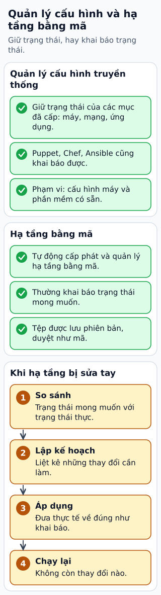

# Quản lý cấu hình từ hạ tầng tới ứng dụng

Ứng dụng chạy tốt ở máy dev nhưng production trỏ nhầm DB. Quản lý cấu hình cần phân biệt ba lớp: tài nguyên được tạo, phần mềm trên máy và giá trị ứng dụng đọc lúc chạy.

**Đọc hình:** Các khung tóm tắt vai trò hoặc lựa chọn để đối chiếu. Các con số và tình huống trong bài là ví dụ minh họa, trừ khi ghi rõ cách tính.

IaC mô tả VPC, instance hoặc DB cần tồn tại. Configuration management giữ các gói, file và dịch vụ trên máy theo trạng thái mong muốn. Runtime config chứa endpoint, timeout và feature flag. Secret như password cần kho bảo mật và quyền truy cập riêng.

Đưa cấu hình không nhạy cảm vào version control, kiểm schema và gắn phiên bản cấu hình với release. Với thay đổi động, triển khai từng nhóm, theo dõi lỗi rồi mở rộng. Giữ cách rollback và giá trị mặc định an toàn. Ví dụ, giảm timeout quá mạnh có thể làm cả đội worker retry, nên thay một nhóm nhỏ trước khi áp dụng toàn bộ.

## Từ viết tắt

- **DB** (DataBase) — cơ sở dữ liệu: nơi lưu dữ liệu có tổ chức để ghi và tìm lại; ví dụ trong bài: ứng dụng chạy tốt ở máy dev nhưng production trỏ nhầm DB.
- **IaC** (Infrastructure as Code) — hạ tầng dưới dạng mã: mô tả máy, mạng và cơ sở dữ liệu bằng tệp mã để tạo lại và kiểm tra lại được; lớp hạ tầng được tạo bằng IaC, được review và kiểm tra lệch.
- **VPC** (Virtual Private Cloud) — đám mây riêng ảo: mạng riêng bạn tự chia trong cloud, gồm các subnet, bảng định tuyến và nhóm bảo mật; tài nguyên được tạo gồm VPC, máy và DB.

## Nhìn hình thử trả lời

Feature flag và mật khẩu DB có nên lưu và cấp quyền như nhau không?

Xem đáp án

Không. Secret cần cách lưu, phân phối và audit hạn chế; feature flag thường có thể được version và review rộng hơn.

## Giới hạn cần nhớ

Configuration management cũng có thể khai báo và tự động hóa. Không chia đơn giản “cấu hình là thủ công, IaC là tự động”; ranh giới công cụ có phần giao nhau.

Xem sâu hơn

Hot reload cần kiểm tra tính hợp lệ và giữ cấu hình cũ khi cấu hình mới lỗi. Cấu hình đã apply cũng cần quan sát tác động, không chỉ kiểm cú pháp.

## Nguồn đối chiếu

- [Mục chủ đề ByteByteGo tại snapshot cố định](https://github.com/ByteByteGoHq/system-design-101/blob/b28380a4710c5ec9638ec037d4168e288f334cba/data/guides/how-do-we-manage-configurations-in-a-system.md).
- [What is Terraform | Terraform | HashiCorp Developer](https://developer.hashicorp.com/terraform/intro).
- [Ansible Documentation — Ansible Community Documentation](https://docs.ansible.com/ansible/latest/index.html).
- [The Twelve-Factor App](https://12factor.net/config).

Bài giải thích và hình được biên soạn độc lập; không dùng ảnh nguồn. Các tài liệu kỹ thuật trên là điểm đối chiếu cho review, không phải chứng nhận mọi claim đã được kiểm chứng.
