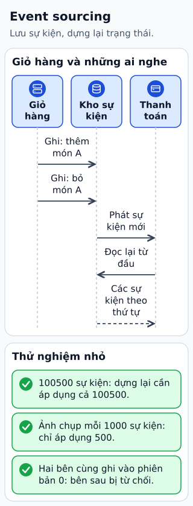

# Đưa Event Sourcing vào một hệ thống

Giỏ hàng có thể lưu trạng thái “một cuốn sách”, hoặc lưu lịch sử “thêm một cuốn”, “thêm một cuốn”, “xóa một cuốn”. Event sourcing chọn lịch sử sự kiện nghiệp vụ làm nguồn để dựng trạng thái hiện tại.

**Đọc hình:** Các khung tóm tắt vai trò hoặc lựa chọn để đối chiếu. Các con số và tình huống trong bài là ví dụ minh họa, trừ khi ghi rõ cách tính.

Command được kiểm tra quy tắc và phiên bản aggregate trước khi append event. Projection đọc event để tạo view thuận tiện cho truy vấn, chẳng hạn tổng số món. Khi thay cấu trúc view, có thể dựng lại từ event nếu lịch sử còn đủ và cách diễn giải được quản lý.

Để dùng thực tế, cần xử lý command đồng thời, event schema, version và consumer idempotent. Việc replay không được tự gửi lại email hay thu tiền; tách tác động bên ngoài khỏi dựng view. Có thể dùng snapshot để rút ngắn đọc lại, nhưng snapshot phải chỉ ra vị trí lịch sử tương ứng. Chỉ chọn mẫu này khi giá trị lịch sử đủ bù chi phí thiết kế.

## Từ viết tắt

- **CDC** (Change Data Capture) — bắt thay đổi dữ liệu: đọc các thay đổi đã chốt của một cơ sở dữ liệu thành một luồng sự kiện để hệ khác chép theo; CDC hoặc việc phát thông điệp từ DB không tự là event sourcing.
- **DB** (DataBase) — cơ sở dữ liệu: nơi lưu dữ liệu có tổ chức để ghi và tìm lại; bài nói thông điệp phát ra từ DB chưa tự là event sourcing.

## Nhìn hình thử trả lời

Consumer replay toàn bộ event để dựng báo cáo. Có nên gửi lại email xác nhận mỗi lần không?

Xem đáp án

Không. Replay projection phải tách khỏi tác động bên ngoài hoặc có cơ chế chống lặp phù hợp.

## Giới hạn cần nhớ

CDC hoặc phát message từ DB không tự là event sourcing. Kafka không tự bảo đảm lịch sử nghiệp vụ đầy đủ, bất biến và giữ mãi.

Xem sâu hơn

Thường dùng optimistic concurrency bằng expected version khi append. Dữ liệu cá nhân trong event bất biến cần thiết kế lưu và xóa phù hợp ngay từ đầu.

## Nguồn đối chiếu

- [Mục chủ đề ByteByteGo tại snapshot cố định](https://github.com/ByteByteGoHq/system-design-101/blob/b28380a4710c5ec9638ec037d4168e288f334cba/data/guides/how-do-we-incorporate-event-sourcing-into-the-systems.md).
- [Event Sourcing Pattern - Azure Architecture Center | Microsoft Learn](https://learn.microsoft.com/en-us/azure/architecture/patterns/event-sourcing).

Bài giải thích và hình được biên soạn độc lập; không dùng ảnh nguồn. Các tài liệu kỹ thuật trên là điểm đối chiếu cho review, không phải chứng nhận mọi claim đã được kiểm chứng.
