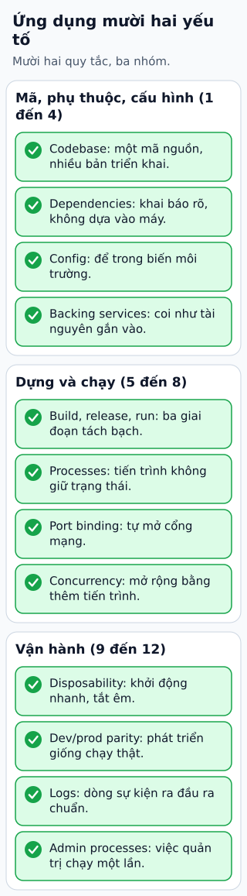

# 12-Factor App: ứng dụng dễ triển khai và vận hành

Một bản ứng dụng cần chạy ở dev, staging và production. Nếu đường dẫn, password và thư viện được cài tay khác nhau, rất khó biết mã hay môi trường gây lỗi. 12-Factor đưa ra các nguyên tắc cho ứng dụng dạng dịch vụ.

**Đọc hình:** Các khung tóm tắt vai trò hoặc lựa chọn để đối chiếu. Các con số và tình huống trong bài là ví dụ minh họa, trừ khi ghi rõ cách tính.

Codebase có version; dependency được khai báo; config tách khỏi mã; backing services được gắn qua cấu hình. Build, release và run là các bước riêng. Process giữ trạng thái bền bên ngoài; port binding cung cấp giao diện phục vụ. Concurrency tăng bằng các loại process.

Disposability yêu cầu khởi động nhanh, dừng có kiểm soát. Dev/prod parity giảm khác biệt giữa môi trường. Log đi ra như luồng sự kiện. Admin process dùng cùng nền tảng release để thực hiện việc một lần.

Ví dụ, worker nhận tín hiệu dừng thì ngừng lấy việc mới, hoàn tất hoặc trả lại việc đang làm. Người vận hành có thể thay instance mà không cần giữ ổ đĩa riêng của worker.

## Nhìn hình thử trả lời

Upload chỉ lưu trên ổ đĩa instance rồi instance bị thay. Nguyên tắc nào cần xem lại?

Xem đáp án

Processes và backing services: đưa upload cần giữ vào kho bền bên ngoài process/instance.

## Giới hạn cần nhớ

Đây là hướng dẫn cho một kiểu ứng dụng, không bảo đảm availability hay bảo mật. Stateless process vẫn có state tạm, chỉ không giữ state bền duy nhất trong process.

Xem sâu hơn

Release kết hợp artifact với cấu hình triển khai; thay config cũng có thể tạo release mới. Log không được chứa credential hoặc dữ liệu cá nhân không cần thiết.

## Nguồn đối chiếu

- [Mục chủ đề ByteByteGo tại snapshot cố định](https://github.com/ByteByteGoHq/system-design-101/blob/b28380a4710c5ec9638ec037d4168e288f334cba/data/guides/the-12-factor-app.md).
- [The Twelve-Factor App](https://12factor.net/).

Bài giải thích và hình được biên soạn độc lập; không dùng ảnh nguồn. Các tài liệu kỹ thuật trên là điểm đối chiếu cho review, không phải chứng nhận mọi claim đã được kiểm chứng.
