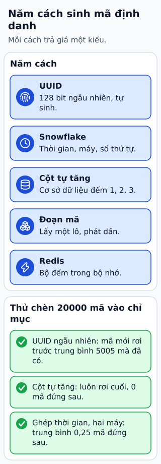

# So sánh năm cách sinh ID

ID của bản ghi có thể cần tạo tại client, tăng gần theo thời gian hoặc không phụ thuộc mạng. Không có bộ sinh nào đáp ứng mọi mục tiêu mà không có điều kiện.

**Đọc hình:** Các khung tóm tắt vai trò hoặc lựa chọn để đối chiếu. Các con số và tình huống trong bài là ví dụ minh họa, trừ khi ghi rõ cách tính.

UUID có nhiều phiên bản: UUIDv4 dùng ngẫu nhiên, UUIDv7 có phần thời gian. Snowflake ghép timestamp, node và sequence. Auto-increment dựa bộ đếm DB, dễ dùng trong phạm vi bảng. Cấp segment lấy cả dải số cho một node để giảm số lần gọi DB. Redis INCR cung cấp bộ đếm nguyên tử trên một instance nhưng cần xét độ bền và failover.

Chọn theo phạm vi duy nhất, tốc độ, thứ tự, khả năng đoán và hành vi khi lỗi. Segment có thể bỏ trống số sau restart; UUID ngẫu nhiên có xác suất va chạm cực nhỏ chứ không bằng không. ID tăng dần cũng có thể lộ nhịp tạo bản ghi; dùng ID ngoài khác khi điều đó quan trọng.

## Từ viết tắt

- **ID** (IDentifier) — mã định danh: chuỗi hoặc số dùng để phân biệt một đối tượng với các đối tượng khác; bài so sánh năm cách sinh ID.
- **UUID** (Universally Unique IDentifier) — mã định danh duy nhất toàn cầu: chuỗi dài sinh ngẫu nhiên, gần như không bao giờ trùng giữa các bản sao; UUID dài 128 bit và có nhiều phiên bản.
- **DB** (DataBase) — cơ sở dữ liệu: nơi lưu dữ liệu có tổ chức để ghi và tìm lại; DB auto-increment là một cách sinh ID dựa trên bộ đếm.

## Nhìn hình thử trả lời

Cần tạo ID offline ở nhiều client. Auto-increment DB hay UUID thuận tiện hơn?

Xem đáp án

UUID thuận tiện hơn vì không cần gọi bộ đếm chung; vẫn cần kiểm tra uniqueness tại nơi ghi nếu yêu cầu nghiệp vụ đòi hỏi.

## Giới hạn cần nhớ

“UUID không có thứ tự” không đúng cho mọi phiên bản. Bộ đếm Redis nguyên tử chưa bảo đảm không tái dùng giá trị sau mất dữ liệu hoặc failover.

Xem sâu hơn

ID tăng gần theo thời gian không thay khóa sắp thứ tự nghiệp vụ. Kiểm cách truyền số nguyên 64 bit cho client và quy tắc xử lý conflict.

## Nguồn đối chiếu

- [Mục chủ đề ByteByteGo tại snapshot cố định](https://github.com/ByteByteGoHq/system-design-101/blob/b28380a4710c5ec9638ec037d4168e288f334cba/data/guides/explaining-5-unique-id-generators-in-distributed-systems.md).
- [RFC 9562: Universally Unique IDentifiers (UUIDs)](https://www.rfc-editor.org/rfc/rfc9562.html).
- [INCR | Docs](https://redis.io/docs/latest/commands/incr/).
- [github.com — snowflake](https://github.com/twitter-archive/snowflake).

Bài giải thích và hình được biên soạn độc lập; không dùng ảnh nguồn. Các tài liệu kỹ thuật trên là điểm đối chiếu cho review, không phải chứng nhận mọi claim đã được kiểm chứng.
