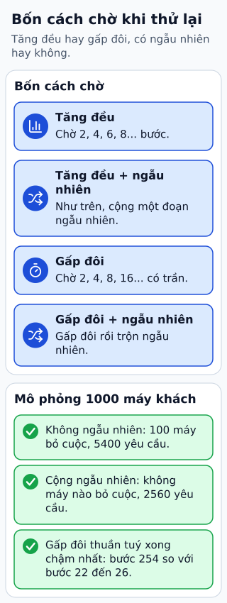

# Retry: chọn khoảng chờ và ngân sách

Hàng nghìn client cùng lỗi lúc 12:00 và đều thử lại đúng một giây sau. Dù server đã phục hồi một phần, đợt request đồng loạt có thể làm nó quá tải lần nữa. Khoảng chờ có jitter làm các client thử lại lệch nhau.

**Đọc hình:** Các khung tóm tắt vai trò hoặc lựa chọn để đối chiếu. Các con số và tình huống trong bài là ví dụ minh họa, trừ khi ghi rõ cách tính.

Linear backoff tăng đều, ví dụ 1, 2, 3 giây. Exponential backoff tăng theo cấp số nhân, ví dụ 1, 2, 4, 8 giây, thường có mức trần. Thêm jitter cho cả hai để rải tải. Với full jitter, có thể chọn ngẫu nhiên trong khoảng từ 0 tới mức chờ đã tính.

Nhưng khoảng chờ chỉ là một phần: xác định lỗi có thể retry, thao tác có lặp an toàn và deadline còn lại. Giới hạn số lần, tổng thời gian hoặc retry budget. Một lời gọi ban đầu cộng ba lần retry là bốn lần thực thi tiềm năng, cần tính tải và chi phí theo đó.

## Nhìn hình thử trả lời

Ba tầng đều cho ba lần thử tổng cộng. Trường hợp xấu có thể tạo bao nhiêu lần gọi tầng cuối?

Xem đáp án

Có thể tới 3 × 3 × 3 = 27 lần, tùy cách retry lồng nhau. Nên chọn tầng chịu trách nhiệm retry và ngân sách đầu cuối.

## Giới hạn cần nhớ

Không áp dụng retry vô hạn cho lỗi cố định. Retry ở nhiều tầng có thể nhân số lời gọi; jitter không sửa tác động nghiệp vụ bị lặp.

Xem sâu hơn

Đặt timeout từ phân phối latency và mục tiêu người dùng. Tôn trọng Retry-After khi phù hợp; một request hết deadline không được tạo công việc mới vô hạn phía sau.

## Nguồn đối chiếu

- [Mục chủ đề ByteByteGo tại snapshot cố định](https://github.com/ByteByteGoHq/system-design-101/blob/b28380a4710c5ec9638ec037d4168e288f334cba/data/guides/how-do-we-retry-on-failures.md).
- [Timeouts, retries, and backoff with jitter | AWS Builder Center](https://aws.amazon.com/builders-library/timeouts-retries-and-backoff-with-jitter/).

Bài giải thích và hình được biên soạn độc lập; không dùng ảnh nguồn. Các tài liệu kỹ thuật trên là điểm đối chiếu cho review, không phải chứng nhận mọi claim đã được kiểm chứng.
