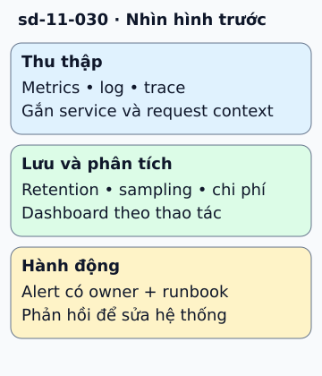

# Giám sát cloud từ tín hiệu tới hành động

CPU đang thấp nhưng người dùng không thanh toán được. Dashboard tài nguyên chưa nói đủ về chất lượng dịch vụ. Bắt đầu giám sát bằng thao tác người dùng và tín hiệu chứng minh thao tác đó thành công.

**Đọc hình:** Các khung tóm tắt vai trò hoặc lựa chọn để đối chiếu. Các con số và tình huống trong bài là ví dụ minh họa, trừ khi ghi rõ cách tính.

Metrics tổng hợp tỷ lệ, latency và mức sử dụng. Log ghi chi tiết sự kiện. Trace nối các hop của một request. Thu thập tín hiệu rồi lưu với thời gian giữ phù hợp; phân tích và hiển thị để tìm xu hướng. Alert cần có người chịu trách nhiệm và hành động cụ thể, thay vì báo mọi biến động.

AWS có CloudWatch, Azure có Azure Monitor, Google Cloud có Cloud Monitoring/Logging. OpenTelemetry hỗ trợ chuẩn thu thập và truyền telemetry, còn Prometheus thường dùng cho metrics. Chọn theo tích hợp và vận hành; không xem các tên này là thay thế hoàn toàn cho nhau. Sau mỗi sự cố, sửa alert và runbook dựa vào tín hiệu đã thiếu.

## Nhìn hình thử trả lời

Alert CPU bình thường nhưng tỷ lệ thanh toán lỗi tăng. Chỉ số nào nên ưu tiên?

Xem đáp án

Tỷ lệ và latency của thao tác thanh toán tốt từ góc nhìn người dùng, rồi dùng telemetry tài nguyên để điều tra nguyên nhân.

## Giới hạn cần nhớ

Log nhiều không tự tạo observability tốt. Label có cardinality cao, trace không sampling và lưu quá lâu có thể tăng chi phí hoặc lộ dữ liệu.

Xem sâu hơn

Đặt SLO, theo dõi error budget và ưu tiên alert theo tốc độ tiêu hao budget. Báo cáo compliance cần dữ liệu và quy trình kiểm riêng, không suy ra từ dashboard.

## Nguồn đối chiếu

- [Mục chủ đề ByteByteGo tại snapshot cố định](https://github.com/ByteByteGoHq/system-design-101/blob/b28380a4710c5ec9638ec037d4168e288f334cba/data/guides/cloud-monitoring-cheat-sheet.md).
- [Documentation | OpenTelemetry](https://opentelemetry.io/docs/).
- [Google SRE - Prometheus Alerting: Turn SLOs into Alerts](https://sre.google/workbook/alerting-on-slos/).
- [Azure Monitor overview - Azure Monitor | Microsoft Learn](https://learn.microsoft.com/en-us/azure/azure-monitor/overview).

Bài giải thích và hình được biên soạn độc lập; không dùng ảnh nguồn. Các tài liệu kỹ thuật trên là điểm đối chiếu cho review, không phải chứng nhận mọi claim đã được kiểm chứng.
