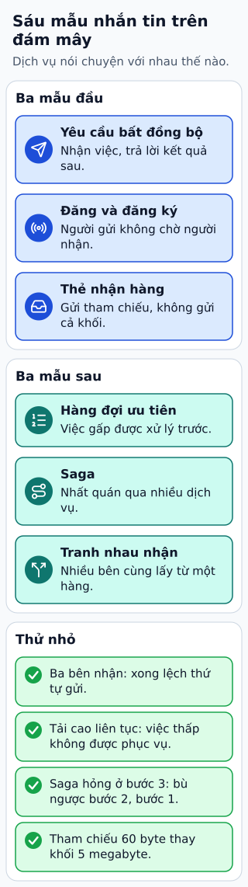

# Sáu mẫu messaging trên cloud

Người dùng yêu cầu xuất một báo cáo lớn. API có thể trả 202 và mã job; worker làm sau, client tra trạng thái. Đây là asynchronous request/reply, giúp không giữ request HTTP quá lâu.

**Đọc hình:** Các khung tóm tắt vai trò hoặc lựa chọn để đối chiếu. Các con số và tình huống trong bài là ví dụ minh họa, trừ khi ghi rõ cách tính.

Pub/sub đưa một sự kiện tới các nhóm quan tâm. Competing consumers để nhiều worker chia công việc từ một kênh. Claim check lưu payload lớn ở object storage và chỉ gửi tham chiếu qua message. Priority queue ưu tiên việc khẩn, nhưng cần tránh bỏ đói việc thường.

Saga phối hợp nhiều bước bằng transaction cục bộ và hành động bù khi cần. Ví dụ, giữ hàng xong mà thu tiền lỗi thì giải phóng hàng. Các mẫu có thể kết hợp: job báo cáo dùng competing consumers, đầu vào lớn dùng claim check và thông báo hoàn tất dùng pub/sub. Mỗi bước phải có trạng thái để xử lý lỗi và message lặp.

## Từ viết tắt

- **API** (Application Programming Interface) — giao diện lập trình ứng dụng: cách để một chương trình yêu cầu dữ liệu hoặc chức năng của chương trình khác; API có thể trả 202 cùng mã job, còn worker làm sau.
- **HTTP** (HyperText Transfer Protocol) — giao thức truyền siêu văn bản: quy ước để trình duyệt gửi yêu cầu và máy chủ gửi trả lời; mẫu này giúp không giữ một yêu cầu HTTP quá lâu.

## Nhìn hình thử trả lời

Cả email và phân tích cần nhận mỗi sự kiện. Có nên dùng hai worker tranh nhau đọc một queue duy nhất không?

Xem đáp án

Không cho yêu cầu này. Dùng subscription riêng cho từng nhóm; competing consumers chỉ chia việc trong cùng nhóm.

## Giới hạn cần nhớ

202 chỉ xác nhận nhận xử lý, chưa phải thành công nghiệp vụ. Saga compensation không phải rollback nguyên tử và có thể cần thử lại hoặc xử lý thủ công.

Xem sâu hơn

Tham chiếu claim check cần quyền đọc, thời gian giữ payload và cách dọn rác. Ordering phụ thuộc queue, partition và consumer chứ không đến từ tên mẫu.

## Nguồn đối chiếu

- [Mục chủ đề ByteByteGo tại snapshot cố định](https://github.com/ByteByteGoHq/system-design-101/blob/b28380a4710c5ec9638ec037d4168e288f334cba/data/guides/top-6-cloud-messaging-patterns.md).
- [Asynchronous Request-Reply Pattern - Azure Architecture Center | Microsoft Learn](https://learn.microsoft.com/en-us/azure/architecture/patterns/async-request-reply).
- [Claim Check pattern - Azure Architecture Center | Microsoft Learn](https://learn.microsoft.com/en-us/azure/architecture/patterns/claim-check).
- [Saga Design Pattern - Azure Architecture Center | Microsoft Learn](https://learn.microsoft.com/en-us/azure/architecture/patterns/saga).
- [Competing Consumers Pattern - Azure Architecture Center | Microsoft Learn](https://learn.microsoft.com/en-us/azure/architecture/patterns/competing-consumers).

Bài giải thích và hình được biên soạn độc lập; không dùng ảnh nguồn. Các tài liệu kỹ thuật trên là điểm đối chiếu cho review, không phải chứng nhận mọi claim đã được kiểm chứng.
