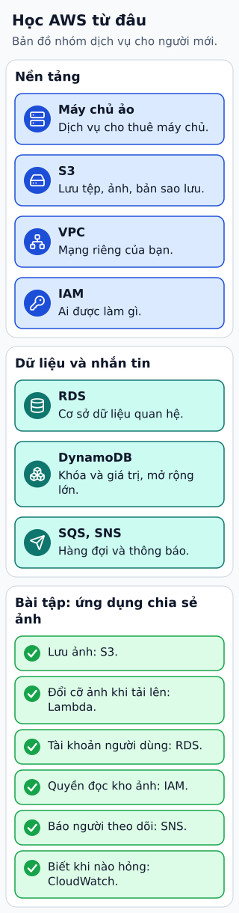

# Học AWS bằng một ứng dụng nhỏ

Thay vì học tên hàng trăm dịch vụ, hãy làm một ứng dụng lưu ảnh. Bắt đầu với IAM để hiểu danh tính và quyền, VPC để hiểu kết nối, rồi chọn EC2 hoặc Lambda cho compute. S3 giữ file; RDS hoặc DynamoDB giữ metadata theo kiểu truy vấn.

**Đọc hình:** Các khung tóm tắt vai trò hoặc lựa chọn để đối chiếu. Các con số và tình huống trong bài là ví dụ minh họa, trừ khi ghi rõ cách tính.

Tiếp theo, đưa web sau load balancer hoặc API Gateway khi phù hợp, dùng Route 53 cho tên miền và CloudFront cho nội dung phân phối. Khi cần xử lý ảnh nền, dùng SQS và worker. CloudWatch cung cấp tín hiệu vận hành; CloudTrail giúp theo dõi hoạt động API được ghi nhận.

Mỗi lượt học nên trả lời: dịch vụ giữ gì, ai có quyền gọi, khi lỗi thì sao và tính phí theo đơn vị nào? Chỉ thêm dịch vụ khi có nhu cầu. Một bài thực hành đầy đủ vòng lưu ảnh, xem ảnh và xử lý lỗi giúp hiểu liên kết giữa các thành phần hơn học riêng từng logo.

## Từ viết tắt

- **AWS** (Amazon Web Services) — dịch vụ điện toán đám mây của Amazon; bài học AWS qua một ứng dụng lưu ảnh nhỏ thay vì học tên hàng trăm dịch vụ.
- **IAM** (Identity and Access Management) — quản lý danh tính và quyền truy cập: cho biết ai là ai và được làm gì với tài nguyên; bài khuyên bắt đầu với IAM, rồi mới tới đường mạng và compute.
- **VPC** (Virtual Private Cloud) — đám mây riêng ảo: mạng riêng bạn tự chia trong cloud, gồm các subnet, bảng định tuyến và nhóm bảo mật; bài khuyên dùng VPC để hiểu kết nối.
- **EC** (Elastic Compute) — điện toán co giãn: phần chữ cái đầu của EC2, dịch vụ máy ảo của Amazon (tên đầy đủ Elastic Compute Cloud, hai chữ C thành số 2); bài khuyên chọn EC2 hoặc Lambda cho compute.
- **RDS** (Relational Database Service) — dịch vụ cơ sở dữ liệu quan hệ do Amazon vận hành hộ: nhà cung cấp lo máy chủ và sao lưu; RDS hoặc DynamoDB giữ metadata theo kiểu truy vấn.
- **DB** (DataBase) — cơ sở dữ liệu: nơi lưu dữ liệu có tổ chức để ghi và tìm lại; ưu tiên IAM, đường mạng, compute, storage, DB và quan sát phù hợp với ứng dụng.
- **LB** (Load Balancer) — bộ cân bằng tải: máy hoặc phần mềm chia lưu lượng cho nhiều bản sao của cùng một dịch vụ; trong hình, LB cùng API Gateway nằm ở nhóm dữ liệu và phục vụ.
- **API** (Application Programming Interface) — giao diện lập trình ứng dụng: cách để một chương trình yêu cầu dữ liệu hoặc chức năng của chương trình khác; xuất hiện trong tên API Gateway, dịch vụ cửa vào trong hình.
- **DNS** (Domain Name System) — hệ thống tên miền: "danh bạ" của Internet, đổi tên miền thành địa chỉ mạng để biết tìm dịch vụ ở đâu; trong hình, DNS đi cùng CDN ở nhóm phục vụ.
- **CDN** (Content Delivery Network) — mạng phân phối nội dung: nhiều máy chủ đặt ở nhiều nơi, lưu bản sao nội dung và phát cho người dùng từ máy gần họ; trong hình, CDN đi cùng DNS ở nhóm phục vụ.
- **SQS** (Simple Queue Service) — dịch vụ hàng đợi thông điệp của Amazon: nơi bên gửi đặt thông điệp để bên nhận lấy ra xử lý sau; SQS cùng worker khi cần, thuộc nhóm vận hành trong hình.

## Nhìn hình thử trả lời

Ứng dụng chỉ lưu file và thông tin chủ file. Có cần học data warehouse trước không?

Xem đáp án

Chưa cần. Ưu tiên IAM, đường mạng, compute, storage, DB và quan sát phù hợp với ứng dụng đó.

## Giới hạn cần nhớ

Không có danh sách “quan trọng nhất” áp dụng mọi đội. Lựa chọn compute và DB phải theo workload, quyền vận hành và ngân sách.

Xem sâu hơn

Dọn tài nguyên sau bài thực hành và theo dõi billing. Kiểm quyền tối thiểu, backup và retry trước khi coi bản demo là đủ cho production.

## Nguồn đối chiếu

- [Mục chủ đề ByteByteGo tại snapshot cố định](https://github.com/ByteByteGoHq/system-design-101/blob/b28380a4710c5ec9638ec037d4168e288f334cba/data/guides/what-are-the-most-important-aws-services-to-learn.md).
- [Overview of Amazon Web Services - Overview of Amazon Web Services](https://docs.aws.amazon.com/whitepapers/latest/aws-overview/introduction.html).
- [What is IAM? - AWS Identity and Access Management](https://docs.aws.amazon.com/IAM/latest/UserGuide/introduction.html).

Bài giải thích và hình được biên soạn độc lập; không dùng ảnh nguồn. Các tài liệu kỹ thuật trên là điểm đối chiếu cho review, không phải chứng nhận mọi claim đã được kiểm chứng.
