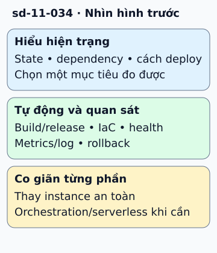

# Chuyển hệ thống sang cloud native từng bước

Ứng dụng cũ giữ session và upload trên một máy. Đóng gói nó vào container chưa làm việc thay máy an toàn. Chuyển sang cloud native bắt đầu bằng loại các phụ thuộc khiến instance không thể thay thế.

**Đọc hình:** Các khung tóm tắt vai trò hoặc lựa chọn để đối chiếu. Các con số và tình huống trong bài là ví dụ minh họa, trừ khi ghi rõ cách tính.

Kiểm kê trạng thái, ranh giới nghiệp vụ và cách triển khai. Đưa dữ liệu bền ra backing service; thêm health check, log và metrics. Tự động hóa build/release, cấu hình và provisioning để có thể lặp lại môi trường. Sau đó thử chạy nhiều bản, rolling update và graceful shutdown.

Các lựa chọn runtime, orchestration hoặc serverless đến sau nhu cầu vận hành. Có thể chuyển dần một chức năng qua API ổn định, quan sát và rollback được. Monolith được thiết kế tốt vẫn có thể co giãn và vận hành trên cloud. Tách microservice chỉ khi ranh giới, ownership và lợi ích triển khai đủ rõ để chấp nhận thêm giao tiếp qua mạng.

## Từ viết tắt

- **API** (Application Programming Interface) — giao diện lập trình ứng dụng: cách để một chương trình yêu cầu dữ liệu hoặc chức năng của chương trình khác; có thể chuyển dần một chức năng qua API ổn định, quan sát và quay lui được.
- **IaC** (Infrastructure as Code) — hạ tầng dưới dạng mã: mô tả máy, mạng và cơ sở dữ liệu bằng tệp mã để tạo lại và kiểm tra lại được; trong hình, IaC cùng build, release và kiểm tra sức khỏe nằm ở bước tự động và quan sát.

## Nhìn hình thử trả lời

Container chứa upload duy nhất trên ổ cục bộ. Đã sẵn sàng thay instance chưa?

Xem đáp án

Chưa. Upload cần đưa vào kho bền bên ngoài; kiểm phục hồi trước khi thay instance.

## Giới hạn cần nhớ

Không đặt Kubernetes hay microservice làm điều kiện bắt buộc cho mọi migration. Lift-and-shift có thể là bước đầu hữu ích nhưng chưa tự chứng minh cloud native.

Xem sâu hơn

Lộ trình nên có tiêu chí cho từng bước: thời gian deploy, rollback, phục hồi node và chi phí. Không cần thay tất cả công nghệ trong một đợt.

## Nguồn đối chiếu

- [Mục chủ đề ByteByteGo tại snapshot cố định](https://github.com/ByteByteGoHq/system-design-101/blob/b28380a4710c5ec9638ec037d4168e288f334cba/data/guides/how-do-we-transform-a-system-to-be-cloud-native.md).
- [toc/DEFINITION.md at main · cncf/toc · GitHub](https://github.com/cncf/toc/blob/main/DEFINITION.md).
- [The Twelve-Factor App](https://12factor.net/).
- [Strangler Fig Pattern - Azure Architecture Center | Microsoft Learn](https://learn.microsoft.com/en-us/azure/architecture/patterns/strangler-fig).

Bài giải thích và hình được biên soạn độc lập; không dùng ảnh nguồn. Các tài liệu kỹ thuật trên là điểm đối chiếu cho review, không phải chứng nhận mọi claim đã được kiểm chứng.
