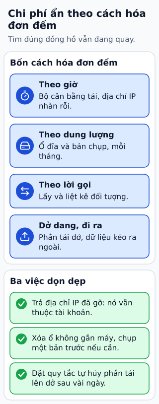

# Chi phí cloud dễ bị bỏ sót

Bạn dừng máy thử nghiệm và nghĩ hóa đơn sẽ về không. Nhưng volume, snapshot, địa chỉ IP và load balancer có thể còn tồn tại. Chi phí theo tài nguyên và mức sử dụng, không chỉ theo việc ứng dụng có khách hay không.

**Đọc hình:** Các khung tóm tắt vai trò hoặc lựa chọn để đối chiếu. Các con số và tình huống trong bài là ví dụ minh họa, trừ khi ghi rõ cách tính.

Ngoài compute, cần nhìn storage, request, data transfer, NAT, load balancer, public IPv4 và observability. File ít nhưng GET/LIST nhiều vẫn có thể tốn phí đáng kể. Multipart upload chưa hoàn tất có thể giữ các phần đã tải. Log giữ lâu hoặc metrics có quá nhiều chuỗi cũng tăng hóa đơn.

Gắn owner và môi trường cho tài nguyên, đặt budget alert và kiểm chi phí theo nhóm hàng tuần. Với một tính năng mới, ước tính cả đường dữ liệu: đọc ở đâu, qua mạng nào và giữ bao lâu. “Free tier” có giới hạn, điều kiện tài khoản và thay đổi theo dịch vụ; phải đối chiếu bảng giá hiện hành.

## Nhìn hình thử trả lời

EC2 đã dừng nhưng EBS volume và snapshot còn. Có thể vẫn bị tính phí không?

Xem đáp án

Có. Dừng compute không đồng nghĩa xóa storage hay các tài nguyên liên quan.

## Giới hạn cần nhớ

Không dùng quy tắc cũ “Elastic IP chỉ tính tiền khi vượt năm địa chỉ”. AWS hiện có mục giá public IPv4; giá và miễn giảm phụ thuộc điều kiện hiện hành.

Xem sâu hơn

Lifecycle có thể dọn incomplete multipart uploads; xóa volume không tự xóa mọi snapshot. Trước khi dọn, kiểm ownership và yêu cầu giữ dữ liệu.

## Nguồn đối chiếu

- [Mục chủ đề ByteByteGo tại snapshot cố định](https://github.com/ByteByteGoHq/system-design-101/blob/b28380a4710c5ec9638ec037d4168e288f334cba/data/guides/hidden-costs-of-the-cloud.md).
- [Amazon VPC Pricing](https://aws.amazon.com/vpc/pricing/).
- [S3 Pricing](https://aws.amazon.com/s3/pricing/).
- [Configuring a bucket lifecycle configuration to delete incomplete multipart uploads - Amazon Simple Storage Service](https://docs.aws.amazon.com/AmazonS3/latest/userguide/mpu-abort-incomplete-mpu-lifecycle-config.html).

Bài giải thích và hình được biên soạn độc lập; không dùng ảnh nguồn. Các tài liệu kỹ thuật trên là điểm đối chiếu cho review, không phải chứng nhận mọi claim đã được kiểm chứng.
