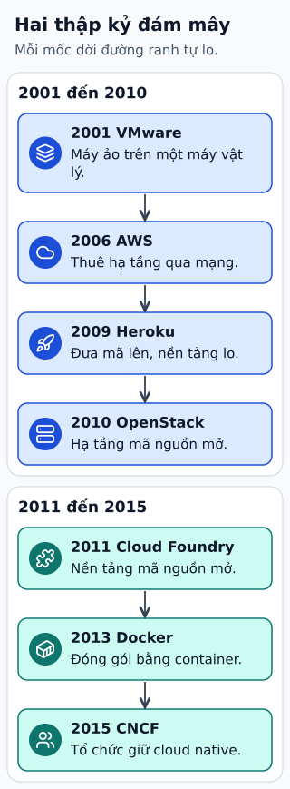

# Cloud tiến hóa: phần trách nhiệm được chuyển đi

Khi vận hành máy vật lý, đội ứng dụng lo phần cứng và nhiều lớp phần mềm. Với virtual machine thuê qua IaaS, nhà cung cấp xử lý hạ tầng vật lý; đội vẫn quản lý hệ điều hành và ứng dụng. PaaS chuyển thêm việc runtime và triển khai cho nền tảng.

**Đọc hình:** Các khung tóm tắt vai trò hoặc lựa chọn để đối chiếu. Các con số và tình huống trong bài là ví dụ minh họa, trừ khi ghi rõ cách tính.

Container chuẩn hóa gói ứng dụng và dependency, còn orchestration quản lý placement, restart và rollout. Serverless cho đội tập trung vào đơn vị xử lý hoặc dịch vụ được quản lý theo sự kiện. Cloud native gắn thiết kế ứng dụng với tự động hóa, quan sát và khả năng thay đổi dưới tải.

Đây là các hướng phát triển chồng lấn, không phải bậc thang loại bỏ công nghệ cũ. VM, container, managed DB và function có thể cùng nằm trong một hệ thống. Càng chuyển trách nhiệm sang nền tảng, càng cần hiểu giới hạn, quyền truy cập và cách tính phí của nền tảng đó.

## Từ viết tắt

- **VM** (Virtual Machine) — máy ảo: máy tính giả lập chạy bằng phần mềm trên một máy thật; VM, container, managed DB và function có thể cùng nằm trong một hệ thống.
- **DB** (DataBase) — cơ sở dữ liệu: nơi lưu dữ liệu có tổ chức để ghi và tìm lại; managed DB là một ví dụ về trách nhiệm được chuyển sang nền tảng.
- **IaaS** (Infrastructure as a Service) — hạ tầng như một dịch vụ: thuê máy, mạng và lưu trữ; đội vẫn tự quản hệ điều hành và ứng dụng; với máy ảo thuê qua IaaS, nhà cung cấp lo hạ tầng vật lý.
- **OS** (Operating System) — hệ điều hành: phần mềm nền quản lý máy và chạy các chương trình khác; đội vẫn quản lý OS và ứng dụng khi dùng IaaS.
- **PaaS** (Platform as a Service) — nền tảng như một dịch vụ: nhà cung cấp lo runtime và triển khai, đội chỉ lo ứng dụng.

## Nhìn hình thử trả lời

Dùng PaaS có nghĩa không còn phải quản lý quyền DB và backup không?

Xem đáp án

Không. Phạm vi trách nhiệm tùy dịch vụ; ứng dụng vẫn phải cấu hình quyền, dữ liệu và mục tiêu phục hồi phù hợp.

## Giới hạn cần nhớ

Không coi năm ra mắt một sản phẩm là năm khai sinh cả khái niệm. Virtualization có lịch sử lâu hơn các mốc cloud phổ biến.

Xem sâu hơn

So sánh các mô hình bằng ma trận trách nhiệm: ai vá OS, ai quản runtime, ai giữ dữ liệu, ai phản ứng sự cố. Chọn theo nhu cầu kiểm soát và năng lực đội.

## Nguồn đối chiếu

- [Mục chủ đề ByteByteGo tại snapshot cố định](https://github.com/ByteByteGoHq/system-design-101/blob/b28380a4710c5ec9638ec037d4168e288f334cba/data/guides/2-decades-of-cloud-evolution.md).
- [SP 800-145, The NIST Definition of Cloud Computing | CSRC](https://csrc.nist.gov/pubs/sp/800/145/final).
- [Shared Responsibility Model - Amazon Web Services (AWS)](https://aws.amazon.com/compliance/shared-responsibility-model/).

Bài giải thích và hình được biên soạn độc lập; không dùng ảnh nguồn. Các tài liệu kỹ thuật trên là điểm đối chiếu cho review, không phải chứng nhận mọi claim đã được kiểm chứng.
