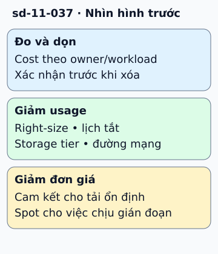

# Giảm chi phí cloud mà vẫn giữ mục tiêu dịch vụ

Hóa đơn tăng không nhất thiết vì nhiều khách hơn. Có thể môi trường test chạy cả đêm, máy quá lớn hoặc dữ liệu đi qua đường mạng đắt. Trước khi cắt, chia chi phí theo workload và tính chi phí trên một thao tác có ích.

**Đọc hình:** Các khung tóm tắt vai trò hoặc lựa chọn để đối chiếu. Các con số và tình huống trong bài là ví dụ minh họa, trừ khi ghi rõ cách tính.

Ưu tiên dọn tài nguyên không dùng sau khi xác nhận chủ sở hữu, right-size theo dữ liệu tải và tắt môi trường không cần liên tục. Giảm request lặp, nén dữ liệu khi có lợi và chọn storage tier theo tần suất đọc, thời gian giữ. Xem data transfer và NAT, không chỉ giá CPU.

Với tải nền ổn định, cân nhắc cam kết giá như Savings Plans hoặc Reserved Instances phù hợp. Spot hợp với việc chịu được gián đoạn và có checkpoint. Sau thay đổi, kiểm latency, lỗi và khả năng phục hồi. Tiết kiệm chỉ có ý nghĩa nếu vẫn giữ yêu cầu nghiệp vụ và không tạo rủi ro mất dữ liệu.

## Nhìn hình thử trả lời

Batch xử lý lại được và có checkpoint, chạy lúc linh hoạt. Có thể cân nhắc gì?

Xem đáp án

Spot hoặc loại compute chi phí thấp phù hợp, kèm cơ chế xử lý interruption và khôi phục từ checkpoint.

## Giới hạn cần nhớ

Cam kết mua trước chưa chắc tiết kiệm nếu dùng sai hoặc tải giảm. Không xóa backup hay giảm redundancy chỉ để làm hóa đơn tháng này thấp hơn.

Xem sâu hơn

Tách giảm usage khỏi giảm unit price. Báo cáo cả thay đổi về chi phí và SLO để tránh chuyển chi phí tiền sang chi phí sự cố.

## Nguồn đối chiếu

- [Mục chủ đề ByteByteGo tại snapshot cố định](https://github.com/ByteByteGoHq/system-design-101/blob/b28380a4710c5ec9638ec037d4168e288f334cba/data/guides/cloud-cost-reduction-techniques.md).
- [Cost Optimization Pillar - AWS Well-Architected Framework - Cost Optimization Pillar](https://docs.aws.amazon.com/wellarchitected/latest/cost-optimization-pillar/welcome.html).
- [Spot Instance interruptions - Amazon Elastic Compute Cloud](https://docs.aws.amazon.com/AWSEC2/latest/UserGuide/spot-interruptions.html).

Bài giải thích và hình được biên soạn độc lập; không dùng ảnh nguồn. Các tài liệu kỹ thuật trên là điểm đối chiếu cho review, không phải chứng nhận mọi claim đã được kiểm chứng.
