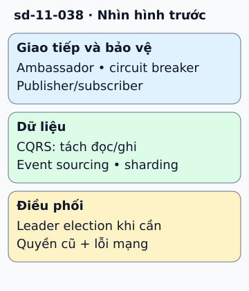

# Bảy mẫu thường dùng trong hệ thống phân tán

Một dịch vụ cần vừa đọc nhanh vừa cập nhật có kiểm soát. Có thể dùng CQRS để tách đường ghi và đường đọc; chưa cần lưu mọi thay đổi dưới dạng event. Event sourcing là lựa chọn khác về nguồn lịch sử, có thể kết hợp CQRS nhưng không bắt buộc.

**Đọc hình:** Các khung tóm tắt vai trò hoặc lựa chọn để đối chiếu. Các con số và tình huống trong bài là ví dụ minh họa, trừ khi ghi rõ cách tính.

Ambassador đặt proxy cạnh ứng dụng để hỗ trợ giao tiếp. Circuit breaker giới hạn gọi phụ thuộc đang hỏng. Leader election chọn bên điều phối theo giao thức; pub/sub chuyển sự kiện tới nhóm quan tâm. Sharding chia workload theo khóa.

Bảy mẫu này giải quyết bảy loại vấn đề, không là bộ bắt buộc phải lắp đủ. Ví dụ, dịch vụ báo cáo có thể dùng pub/sub để nhận dữ liệu và CQRS để dựng view đọc. Chỉ thêm leader election nếu có trách nhiệm cần một bên điều phối, và phải xử lý quyền của leader cũ khi mạng bị chia.

## Nhìn hình thử trả lời

Tách API ghi và view đọc nhưng chỉ lưu trạng thái hiện tại. Có phải event sourcing không?

Xem đáp án

Không. Đó có thể là CQRS; event sourcing đòi hỏi lịch sử event làm nguồn dựng trạng thái.

## Giới hạn cần nhớ

CQRS không đồng nghĩa event sourcing. Có leader chưa đủ cho đồng thuận, và sidecar proxy không tự loại mọi lỗi mạng.

Xem sâu hơn

Mỗi mẫu cần ghi failure mode riêng: projection trễ, broker lỗi, shard nóng, proxy quá tải hoặc leader cũ còn chạy. Theo dõi các tín hiệu đó.

## Nguồn đối chiếu

- [Mục chủ đề ByteByteGo tại snapshot cố định](https://github.com/ByteByteGoHq/system-design-101/blob/b28380a4710c5ec9638ec037d4168e288f334cba/data/guides/top-7-most-used-distributed-system-patterns.md).
- [Ambassador Pattern - Azure Architecture Center | Microsoft Learn](https://learn.microsoft.com/en-us/azure/architecture/patterns/ambassador).
- [CQRS Pattern - Azure Architecture Center | Microsoft Learn](https://learn.microsoft.com/en-us/azure/architecture/patterns/cqrs).
- [Leader Election pattern - Azure Architecture Center | Microsoft Learn](https://learn.microsoft.com/en-us/azure/architecture/patterns/leader-election).

Bài giải thích và hình được biên soạn độc lập; không dùng ảnh nguồn. Các tài liệu kỹ thuật trên là điểm đối chiếu cho review, không phải chứng nhận mọi claim đã được kiểm chứng.
