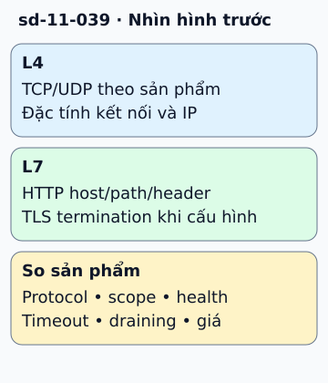

# Chọn load balancer cloud theo đường request

Website có hai nhóm API: /images và /checkout. Nếu cần định tuyến theo path hoặc host, chọn load balancer có khả năng xử lý HTTP ở layer 7. Nếu cần phân phối kết nối TCP hoặc đặc tính transport phù hợp, xem lựa chọn layer 4.

**Đọc hình:** Các khung tóm tắt vai trò hoặc lựa chọn để đối chiếu. Các con số và tình huống trong bài là ví dụ minh họa, trừ khi ghi rõ cách tính.

Trên AWS, ALB và NLB là các tên thường gặp. Azure phân biệt Load Balancer với các lựa chọn HTTP như Application Gateway; Google Cloud cũng có các họ application và network load balancer. Phạm vi global/regional, protocol, TLS termination và health check khác theo sản phẩm.

Bắt đầu bằng bảng yêu cầu: traffic từ internet hay nội bộ, protocol nào, TLS kết thúc ở đâu, cần giữ client IP hay session affinity không? Sau đó xem failover, timeout và cách triển khai backend. Một thiết kế tốt còn có kiểm tra backend sẵn sàng, tránh route request tới máy chưa khởi tạo xong.

## Từ viết tắt

- **AWS** (Amazon Web Services) — dịch vụ điện toán đám mây của Amazon; trên AWS, ALB và NLB là các tên thường gặp.
- **ALB** (Application Load Balancer) — bộ cân bằng tải tầng ứng dụng của Amazon: hiểu được nội dung yêu cầu web nên chia tải theo đường dẫn hoặc tên miền.
- **NLB** (Network Load Balancer) — bộ cân bằng tải tầng mạng của Amazon: chia các kết nối theo giao thức truyền tải.
- **API** (Application Programming Interface) — giao diện lập trình ứng dụng: cách để một chương trình yêu cầu dữ liệu hoặc chức năng của chương trình khác; ví dụ trong bài: website có hai nhóm API là /images và /checkout, cần định tuyến theo path.
- **DB** (DataBase) — cơ sở dữ liệu: nơi lưu dữ liệu có tổ chức để ghi và tìm lại; load balancer không sửa được DB quá tải.
- **HTTP** (HyperText Transfer Protocol) — giao thức truyền siêu văn bản: quy ước để trình duyệt gửi yêu cầu và máy chủ gửi trả lời; load balancer xử lý HTTP ở layer 7 để định tuyến theo path hoặc host.
- **TCP** (Transmission Control Protocol) — giao thức điều khiển truyền: tạo kết nối đáng tin cậy, dữ liệu đến đủ và đúng thứ tự; layer 4 phân phối kết nối TCP.
- **UDP** (User Datagram Protocol) — giao thức gói dữ liệu người dùng: gửi gói tin đơn giản, nhanh, không có kết nối và không bảo đảm đến đủ hay đúng thứ tự; layer 4 cũng gồm UDP, tùy sản phẩm.
- **IP** (Internet Protocol) — giao thức Internet: quy ước đánh địa chỉ và chuyển gói tin giữa các máy; địa chỉ IP là địa chỉ của một máy trên mạng; ở layer 4, bài nói đến đặc tính kết nối và IP.
- **TLS** (Transport Layer Security) — bảo mật tầng truyền tải: lớp mã hóa giữ kín dữ liệu giữa client và máy chủ; ở layer 7, việc kết thúc TLS có thể cấu hình tại load balancer.

## Nhìn hình thử trả lời

Cần chọn backend theo /checkout. Chỉ cân bằng TCP có đủ thông tin không?

Xem đáp án

Không. Cần thành phần đọc HTTP request để định tuyến theo path, thông thường là layer 7.

## Giới hạn cần nhớ

Load balancer không bảo đảm tải chia đều từng request, không sửa DB quá tải và không tự bảo đảm zero downtime. Các sản phẩm cùng vai trò không có tính năng giống hệt.

Xem sâu hơn

Kiểm timeout, connection draining, sticky session và hành vi khi tất cả backend unhealthy. Với session affinity, vẫn cần chiến lược khi backend được thay.

## Nguồn đối chiếu

- [Mục chủ đề ByteByteGo tại snapshot cố định](https://github.com/ByteByteGoHq/system-design-101/blob/b28380a4710c5ec9638ec037d4168e288f334cba/data/guides/cloud-load-balancer-cheat-sheet.md).
- [What is Elastic Load Balancing? - Elastic Load Balancing](https://docs.aws.amazon.com/elasticloadbalancing/latest/userguide/what-is-load-balancing.html).
- [Load Balancing Options - Azure Architecture Center | Microsoft Learn](https://learn.microsoft.com/en-us/azure/architecture/guide/technology-choices/load-balancing-overview).
- [Cloud Load Balancing overview | Google Cloud Documentation](https://cloud.google.com/load-balancing/docs/load-balancing-overview).

Bài giải thích và hình được biên soạn độc lập; không dùng ảnh nguồn. Các tài liệu kỹ thuật trên là điểm đối chiếu cho review, không phải chứng nhận mọi claim đã được kiểm chứng.
