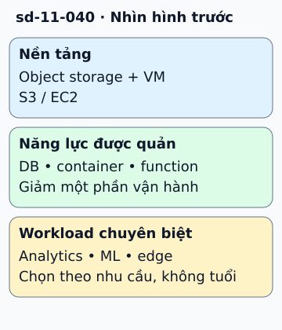

# AWS mở rộng dịch vụ theo lớp năng lực

AWS ban đầu được nhiều người biết qua storage và compute, rồi mở rộng sang DB được quản lý, analytics, container, serverless và học máy. Nhìn theo lớp năng lực giúp hiểu tại sao một ứng dụng không phải tự xây mọi phần từ máy ảo.

**Đọc hình:** Các khung tóm tắt vai trò hoặc lựa chọn để đối chiếu. Các con số và tình huống trong bài là ví dụ minh họa, trừ khi ghi rõ cách tính.

Một lộ trình minh họa là S3/EC2 cho lưu trữ và compute; RDS/DynamoDB cho các nhu cầu dữ liệu khác nhau; Lambda và dịch vụ container cho mô hình thực thi; các dịch vụ phân tích và ML cho workload chuyên biệt. Đây là bản đồ học theo trách nhiệm, không là danh sách mọi dịch vụ hay xếp hạng chất lượng.

Khi chọn dịch vụ mới, hỏi nó giảm phần vận hành nào và thêm ràng buộc nào. Managed DB giảm nhiều việc vận hành nhưng ứng dụng vẫn thiết kế schema, quyền và truy vấn. Function giảm việc quản lý server nhưng cần xử lý timeout, concurrency và phụ thuộc. Sự phát triển của catalog không xóa trách nhiệm của ứng dụng.

## Nhìn hình thử trả lời

Dịch vụ ra mắt sau có mặc định thay hoàn toàn dịch vụ trước không?

Xem đáp án

Không. Chúng có thể phục vụ workload khác nhau và cùng tồn tại; chọn theo yêu cầu hiện tại.

## Giới hạn cần nhớ

Preview, announcement và general availability là các mốc khác nhau. Không dùng một timeline cũ để suy ra tình trạng hỗ trợ hiện tại.

Xem sâu hơn

Tài liệu chọn dịch vụ nên lưu ngày tra cứu và Region được hỗ trợ. Khi cần timeline lịch sử chính xác, đối chiếu thông báo ra mắt từng sản phẩm.

## Nguồn đối chiếu

- [Mục chủ đề ByteByteGo tại snapshot cố định](https://github.com/ByteByteGoHq/system-design-101/blob/b28380a4710c5ec9638ec037d4168e288f334cba/data/guides/aws-services-evolution.md).
- [Our Origins](https://aws.amazon.com/about-aws/our-origins/).
- [Overview of Amazon Web Services - Overview of Amazon Web Services](https://docs.aws.amazon.com/whitepapers/latest/aws-overview/introduction.html).

Bài giải thích và hình được biên soạn độc lập; không dùng ảnh nguồn. Các tài liệu kỹ thuật trên là điểm đối chiếu cho review, không phải chứng nhận mọi claim đã được kiểm chứng.
