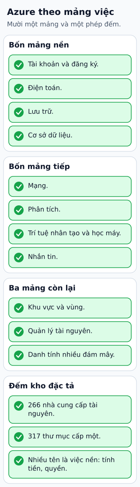

# Bảng tra Azure theo nhu cầu ứng dụng

Một hệ thống nhận file cần compute, kho file, metadata, messaging và quan sát. Trên Azure, có thể xem Virtual Machines cho VM, App Service cho ứng dụng web được quản và Functions cho xử lý theo sự kiện. Container Apps hoặc AKS phục vụ các nhu cầu container khác nhau.

**Đọc hình:** Các khung tóm tắt vai trò hoặc lựa chọn để đối chiếu. Các con số và tình huống trong bài là ví dụ minh họa, trừ khi ghi rõ cách tính.

Blob Storage giữ object; Azure SQL Database cho dữ liệu quan hệ; Cosmos DB cho workload phù hợp với model và consistency đã chọn. Service Bus hỗ trợ messaging doanh nghiệp; Event Hubs hợp với luồng sự kiện lớn. Virtual Network tổ chức mạng; Microsoft Entra ID và Azure RBAC phục vụ danh tính và quyền ở các phạm vi liên quan.

Azure Monitor hỗ trợ quan sát; Key Vault giữ secret, key và certificate theo khả năng dịch vụ. Chọn một đường xử lý file trước, rồi tra từng dịch vụ bằng yêu cầu API, giới hạn, Region và giá. Tên cùng nhóm không có nghĩa có thể thay trực tiếp cho nhau.

## Từ viết tắt

- **AKS** (Azure Kubernetes Service) — dịch vụ Kubernetes được quản lý của Azure: chạy và điều phối container, nhà cung cấp lo phần điều khiển cụm; Container Apps hoặc AKS phục vụ các nhu cầu container khác nhau.
- **VM** (Virtual Machine) — máy ảo: máy tính giả lập chạy bằng phần mềm trên một máy thật; trên Azure, Virtual Machines là lựa chọn cho VM.
- **API** (Application Programming Interface) — giao diện lập trình ứng dụng: cách để một chương trình yêu cầu dữ liệu hoặc chức năng của chương trình khác; bài khuyên tra từng dịch vụ bằng yêu cầu API, giới hạn, Region và giá.
- **DB** (DataBase) — cơ sở dữ liệu: nơi lưu dữ liệu có tổ chức để ghi và tìm lại; trong hình, Cosmos DB thuộc nhóm dữ liệu và messaging.
- **SQL** (Structured Query Language) — ngôn ngữ truy vấn có cấu trúc: ngôn ngữ chuẩn để hỏi và ghi dữ liệu trong cơ sở dữ liệu quan hệ; trong hình, SQL thuộc nhóm dữ liệu cùng Blob và Cosmos DB.
- **ID** (IDentifier) — mã định danh: chuỗi hoặc số dùng để phân biệt một đối tượng với các đối tượng khác; trong hình, Entra ID đi cùng RBAC ở nhóm vận hành.
- **RBAC** (Role-Based Access Control) — kiểm soát truy cập theo vai trò: quyền gắn với vai trò, người dùng được gán vai trò; trong hình, Entra ID và RBAC thuộc nhóm vận hành.

## Nhìn hình thử trả lời

Cần queue tác vụ có khả năng xử lý lại khi worker lỗi. Có nên chỉ chọn theo chữ “event” trong tên không?

Xem đáp án

Không. Cần so yêu cầu queue/task với delivery, lock, retry và dead-letter của sản phẩm; Service Bus là một lựa chọn cần xem.

## Giới hạn cần nhớ

Event Hubs, Event Grid và Service Bus giải quyết nhu cầu khác nhau. Kiểm delivery, ordering và retry thay vì gọi tất cả là “queue”.

Xem sâu hơn

Bảng tra chỉ là điểm bắt đầu. Không bỏ qua cấu hình identity, private access, quota và backup cho tài nguyên được quản lý.

## Nguồn đối chiếu

- [Mục chủ đề ByteByteGo tại snapshot cố định](https://github.com/ByteByteGoHq/system-design-101/blob/b28380a4710c5ec9638ec037d4168e288f334cba/data/guides/azure-services-cheat-sheet.md).
- [Choose an Azure Compute Service - Azure Architecture Center | Microsoft Learn](https://learn.microsoft.com/en-us/azure/architecture/guide/technology-choices/compute-decision-tree).
- [Compare Messaging Services - Azure Service Bus | Microsoft Learn](https://learn.microsoft.com/en-us/azure/service-bus-messaging/compare-messaging-services).

Bài giải thích và hình được biên soạn độc lập; không dùng ảnh nguồn. Các tài liệu kỹ thuật trên là điểm đối chiếu cho review, không phải chứng nhận mọi claim đã được kiểm chứng.
