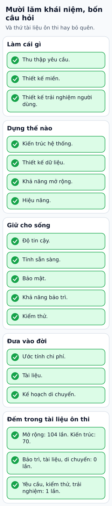

# Mười lăm câu hỏi kiểm lại bản thiết kế

Trước khi chốt thiết kế một ứng dụng đặt lịch, kiểm xem đã trả lời đủ các mặt của bài toán chưa. Một sơ đồ hạ tầng đẹp chưa thay cho yêu cầu, mô hình dữ liệu hoặc kế hoạch migration.

**Đọc hình:** Các khung tóm tắt vai trò hoặc lựa chọn để đối chiếu. Các con số và tình huống trong bài là ví dụ minh họa, trừ khi ghi rõ cách tính.

Mười lăm mục kiểm là: yêu cầu, kiến trúc, dữ liệu, domain, mở rộng, độ tin cậy, availability, hiệu năng, bảo mật, khả năng bảo trì, testing, trải nghiệm người dùng, chi phí, tài liệu và migration.

Dùng từng mục như một câu hỏi cụ thể. Dữ liệu: hai người giữ cùng giờ được xử lý ra sao? Availability: khi DB lỗi, thao tác nào còn dùng được? UX: timeout thì người dùng biết lịch đã đặt hay chưa? Migration: ứng dụng cũ và mới có thể chạy cùng lúc không?

Ghi giả định chưa kiểm chứng cùng người chịu trách nhiệm và bước xác minh. Checklist giúp phát hiện chỗ thiếu, không bắt buộc mỗi mục có thêm một công nghệ. Nhiều câu trả lời có thể nằm trong thiết kế đơn giản.

## Từ viết tắt

- **LB** (Load Balancer) — bộ cân bằng tải: máy hoặc phần mềm chia lưu lượng cho nhiều bản sao của cùng một dịch vụ; ví dụ trong bài: bản thiết kế có LB, cache và DB nhưng chưa nói cách rollback migration.
- **DB** (DataBase) — cơ sở dữ liệu: nơi lưu dữ liệu có tổ chức để ghi và tìm lại; một trong mười lăm câu hỏi của bài hỏi khi DB lỗi thì thao tác nào còn dùng được.
- **UX** (User Experience) — trải nghiệm người dùng: cảm nhận của người dùng khi dùng sản phẩm từ đầu đến cuối; một trong mười lăm câu hỏi của bài hỏi khi hết thời gian chờ thì người dùng có biết lịch đã đặt hay chưa.

## Nhìn hình thử trả lời

Bản thiết kế có LB, cache và DB nhưng chưa nói cách rollback migration. Mục nào còn thiếu?

Xem đáp án

Migration plan và kiểm chứng tương thích/rollback; sơ đồ phục vụ request chưa giải quyết thay đổi dữ liệu.

## Giới hạn cần nhớ

Đánh dấu đủ mục không chứng minh hệ thống đúng. Cần kiểm các đường quan trọng, dữ liệu đồng thời và hành vi khi lỗi.

Xem sâu hơn

Ưu tiên review bằng kịch bản: tải đỉnh, lỗi phụ thuộc, thay phiên bản và thao tác nhạy cảm. Mỗi giả định nên có bằng chứng hoặc phép thử dự kiến.

## Nguồn đối chiếu

- [Mục chủ đề ByteByteGo tại snapshot cố định](https://github.com/ByteByteGoHq/system-design-101/blob/b28380a4710c5ec9638ec037d4168e288f334cba/data/guides/a-cheat-sheet-for-system-designs.md).
- [AWS Well-Architected Framework - AWS Well-Architected Framework](https://docs.aws.amazon.com/wellarchitected/latest/framework/welcome.html).
- [Google SRE - Deployment Strategies for Product Launches](https://sre.google/sre-book/reliable-product-launches/).

Bài giải thích và hình được biên soạn độc lập; không dùng ảnh nguồn. Các tài liệu kỹ thuật trên là điểm đối chiếu cho review, không phải chứng nhận mọi claim đã được kiểm chứng.
