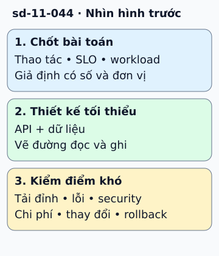

# Blueprint: trình bày một thiết kế có lý do

Trong buổi thiết kế URL shortener, đừng bắt đầu bằng cache hay Kafka. Chốt thao tác tạo và đọc link, thời gian giữ, mục tiêu latency, tải và chính sách chống lạm dụng trước.

**Đọc hình:** Các khung tóm tắt vai trò hoặc lựa chọn để đối chiếu. Các con số và tình huống trong bài là ví dụ minh họa, trừ khi ghi rõ cách tính.

Ước lượng lưu lượng và dung lượng bằng giả định rõ. Định nghĩa API, key và dữ liệu; vẽ đường ghi và đọc tối thiểu. Sau đó giải thích từng thành phần: LB chia tải ứng dụng, DB giữ mapping bền, cache giảm đọc phổ biến, queue làm việc nền nếu có.

Đi sâu vào điểm khó thực sự, như sinh key không trùng, redirect link đã xóa, cache cũ hoặc dữ liệu khi failover. Nêu phương án thay thế và lý do chọn. Kiểm lại observability, quyền, backup và chi phí. Một blueprint tốt dẫn cuộc thảo luận từ yêu cầu đến cơ chế và giới hạn; nó không là sơ đồ phải sao chép nguyên cho mọi bài toán.

## Từ viết tắt

- **API** (Application Programming Interface) — giao diện lập trình ứng dụng: cách để một chương trình yêu cầu dữ liệu hoặc chức năng của chương trình khác; bước thiết kế tối thiểu của blueprint: API và dữ liệu.
- **SLO** (Service Level Objective) — mục tiêu mức dịch vụ: con số cam kết về độ tin cậy, như tỉ lệ yêu cầu thành công trong một khoảng thời gian; bước chốt bài toán gồm thao tác, SLO và workload.
- **CDN** (Content Delivery Network) — mạng phân phối nội dung: nhiều máy chủ đặt ở nhiều nơi, lưu bản sao nội dung và phát cho người dùng từ máy gần họ; bài nói không có công thức bắt buộc mọi hệ thống dùng gateway, CDN, queue và microservice.
- **LB** (Load Balancer) — bộ cân bằng tải: máy hoặc phần mềm chia lưu lượng cho nhiều bản sao của cùng một dịch vụ; trong ví dụ, LB chia tải ứng dụng.
- **DB** (DataBase) — cơ sở dữ liệu: nơi lưu dữ liệu có tổ chức để ghi và tìm lại; trong ví dụ, DB giữ ánh xạ bền.
- **URL** (Uniform Resource Locator) — địa chỉ đầy đủ của một tài nguyên trên web, ví dụ địa chỉ một trang; ví dụ trong bài là thiết kế URL shortener.

## Nhìn hình thử trả lời

Chưa biết tỷ lệ đọc/ghi nhưng đã chọn sharding theo người dùng. Vấn đề là gì?

Xem đáp án

Lựa chọn đi trước dữ kiện. Cần hiểu truy vấn và workload để xem khóa shard có tránh truy cập xuyên shard và hotspot không.

## Giới hạn cần nhớ

Không có công thức bắt buộc mọi hệ thống dùng gateway, CDN, queue và microservice. Chọn thành phần bằng trách nhiệm cụ thể.

Xem sâu hơn

Ghi cả điều chưa biết và phép đo sẽ quyết định. Với hệ đang chạy, thêm lộ trình chuyển đổi và rollback chứ không chỉ kiến trúc đích.

## Nguồn đối chiếu

- [Mục chủ đề ByteByteGo tại snapshot cố định](https://github.com/ByteByteGoHq/system-design-101/blob/b28380a4710c5ec9638ec037d4168e288f334cba/data/guides/system-design-blueprint-the-ultimate-guide.md).
- [AWS Well-Architected Framework - AWS Well-Architected Framework](https://docs.aws.amazon.com/wellarchitected/latest/framework/welcome.html).
- [Google SRE - Deployment Strategies for Product Launches](https://sre.google/sre-book/reliable-product-launches/).

Bài giải thích và hình được biên soạn độc lập; không dùng ảnh nguồn. Các tài liệu kỹ thuật trên là điểm đối chiếu cho review, không phải chứng nhận mọi claim đã được kiểm chứng.
