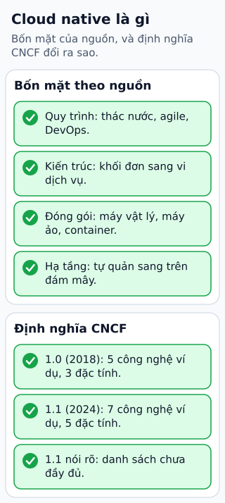

# Cloud native là cách thiết kế và vận hành

Một ứng dụng có thể chạy trên cloud mà mỗi lần deploy vẫn phải SSH vào máy để sửa file. Nó đã đổi nơi đặt máy, nhưng chưa tận dụng được khả năng triển khai lặp lại và thay instance an toàn.

**Đọc hình:** Các khung tóm tắt vai trò hoặc lựa chọn để đối chiếu. Các con số và tình huống trong bài là ví dụ minh họa, trừ khi ghi rõ cách tính.

Cloud native hướng tới các hệ có coupling phù hợp, dễ quan sát, có khả năng phục hồi và vận hành bằng tự động hóa. Container, microservice, declarative API và service mesh là các ví dụ công nghệ, không là danh sách bắt buộc cho mọi ứng dụng. Public, private và hybrid cloud đều có thể áp dụng các nguyên tắc này.

Trong một dịch vụ nhỏ, bắt đầu từ artifact bất biến, cấu hình bên ngoài mã, state bền ở backing service, health check và graceful shutdown. Đội cần feedback từ metrics/log/trace, cách rollout và rollback. Một monolith được thiết kế tốt cũng có thể đáp ứng nhiều đặc tính đó; chia nhỏ quá sớm có thể khiến vận hành khó hơn.

## Từ viết tắt

- **API** (Application Programming Interface) — giao diện lập trình ứng dụng: cách để một chương trình yêu cầu dữ liệu hoặc chức năng của chương trình khác; declarative API là một ví dụ công nghệ cloud native, không bắt buộc cho mọi ứng dụng.
- **SSH** (Secure SHell) — vỏ lệnh an toàn: cách đăng nhập và điều khiển máy từ xa qua kết nối được mã hóa; ví dụ trong bài: một ứng dụng chạy trên cloud mà mỗi lần deploy vẫn phải SSH vào máy để sửa file.
- **VM** (Virtual Machine) — máy ảo: máy tính giả lập chạy bằng phần mềm trên một máy thật; trong hình, VM là một lựa chọn công nghệ cạnh container và function.

## Nhìn hình thử trả lời

Chạy monolith có autoscaling, deployment tự động và state ngoài process có thể áp dụng nguyên tắc cloud native không?

Xem đáp án

Có. Đánh giá đặc tính thiết kế và vận hành thay vì chỉ số service hoặc sản phẩm dùng.

## Giới hạn cần nhớ

Cloud native không đồng nghĩa bắt buộc public cloud, Kubernetes hoặc microservice. Công nghệ chỉ hữu ích khi giải quyết được mục tiêu của ứng dụng và đội.

Xem sâu hơn

Tự động hóa cần có guardrail: kiểm cấu hình, rollout từng phần, quan sát và khả năng rollback. Auto-restart không thay việc xử lý lỗi dữ liệu.

## Nguồn đối chiếu

- [Mục chủ đề ByteByteGo tại snapshot cố định](https://github.com/ByteByteGoHq/system-design-101/blob/b28380a4710c5ec9638ec037d4168e288f334cba/data/guides/what-is-cloud-native.md).
- [toc/DEFINITION.md at main · cncf/toc · GitHub](https://github.com/cncf/toc/blob/main/DEFINITION.md).
- [The Twelve-Factor App](https://12factor.net/).

Bài giải thích và hình được biên soạn độc lập; không dùng ảnh nguồn. Các tài liệu kỹ thuật trên là điểm đối chiếu cho review, không phải chứng nhận mọi claim đã được kiểm chứng.
