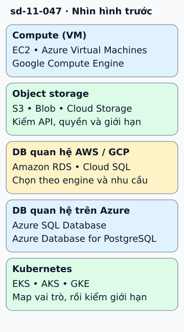

# So sánh AWS, Azure và Google Cloud theo vai trò

Đội muốn chuyển một ứng dụng giữa cloud cần map trách nhiệm trước khi map tên sản phẩm. VM có EC2, Azure Virtual Machines và Compute Engine. Object storage có S3, Blob Storage và Cloud Storage. Các tên này giúp tìm điểm bắt đầu tra tài liệu.

**Đọc hình:** Các khung tóm tắt vai trò hoặc lựa chọn để đối chiếu. Các con số và tình huống trong bài là ví dụ minh họa, trừ khi ghi rõ cách tính.

Với managed relational DB, có thể xem RDS, Azure SQL hoặc Azure Database for PostgreSQL và Cloud SQL tùy engine. Với Kubernetes được quản, xem EKS, AKS và GKE. Với function, xem Lambda, Azure Functions và Cloud Run functions. Các nhóm có thể chứa nhiều lựa chọn khác nữa.

Sau ánh xạ, kiểm API, identity, network, Region, quota, SLA và chi phí. Ví dụ, chuyển object storage không chỉ thay endpoint: phải xét quyền, event notification, consistency và thư viện client. Mục tiêu multi-cloud cũng cần lợi ích rõ, vì nó thêm phần vận hành và kiểm thử tương thích.

## Nhìn hình thử trả lời

S3 và Blob Storage đều lưu object. Có thể chỉ đổi URL rồi coi migration xong không?

Xem đáp án

Không. Cần kiểm API, quyền, key, metadata, sự kiện và tính đúng của dữ liệu đã chuyển.

## Giới hạn cần nhớ

Cùng vai trò không có nghĩa tương đương tính năng hay thay trực tiếp không sửa mã. Tên, gói và hỗ trợ của dịch vụ thay đổi theo thời gian.

Xem sâu hơn

Chọn engine chung có thể giảm chi phí chuyển đổi, nhưng vẫn có khác biệt ở backup, HA và IAM. Thử migration với workload và failure mode thực tế.

## Nguồn đối chiếu

- [Mục chủ đề ByteByteGo tại snapshot cố định](https://github.com/ByteByteGoHq/system-design-101/blob/b28380a4710c5ec9638ec037d4168e288f334cba/data/guides/cloud-comparison-cheat-sheet.md).
- [Compare AWS and Azure services to Google Cloud | Get started | Google Cloud Documentation](https://cloud.google.com/docs/get-started/aws-azure-gcp-service-comparison).
- [Azure for AWS Professionals - Azure Architecture Center | Microsoft Learn](https://learn.microsoft.com/en-us/azure/architecture/aws-professional/services).

Bài giải thích và hình được biên soạn độc lập; không dùng ảnh nguồn. Các tài liệu kỹ thuật trên là điểm đối chiếu cho review, không phải chứng nhận mọi claim đã được kiểm chứng.
