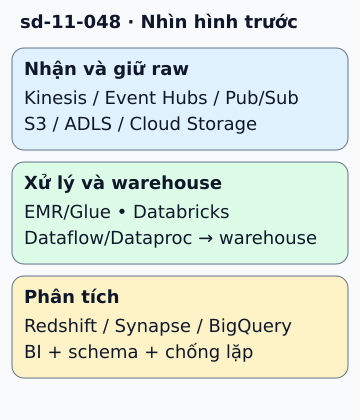

# Pipeline dữ liệu lớn trên ba cloud

Cửa hàng gửi sự kiện mua hàng để làm báo cáo. Pipeline thường có bước nhận dữ liệu, giữ bản raw, xử lý, lưu mô hình phân tích và hiển thị. Tách các bước giúp replay khi logic xử lý thay đổi.

**Đọc hình:** Các khung tóm tắt vai trò hoặc lựa chọn để đối chiếu. Các con số và tình huống trong bài là ví dụ minh họa, trừ khi ghi rõ cách tính.

Một ánh xạ tham khảo: AWS dùng Kinesis hoặc dịch vụ ingestion phù hợp, S3 làm data lake, EMR/Glue xử lý và Redshift cho warehouse. Azure có Event Hubs, ADLS Gen2, Databricks hoặc công cụ xử lý khác, rồi Synapse cho phân tích warehouse. Google Cloud có Pub/Sub, Cloud Storage, Dataflow/Dataproc và BigQuery.

Báo cáo có thể đi qua QuickSight, Power BI hoặc công cụ BI phù hợp, trong đó có Looker Studio. Chọn batch hay streaming theo độ trễ cần có. Các tầng phải thống nhất schema, timestamp và cách nhận diện sự kiện lặp; chart đẹp chưa chứng minh dữ liệu đủ hoặc đúng.

## Từ viết tắt

- **AWS** (Amazon Web Services) — dịch vụ điện toán đám mây của Amazon; một ánh xạ tham khảo: AWS dùng Kinesis, S3 làm data lake và EMR hoặc Glue xử lý.
- **EMR** (Elastic MapReduce) — dịch vụ xử lý dữ liệu lớn của Amazon: chạy các khung xử lý như Spark hay Hadoop trên một cụm máy; EMR cùng Glue là bước xử lý trên AWS.
- **ADLS** (Azure Data Lake Storage) — kho lưu trữ hồ dữ liệu của Azure: nơi giữ lượng lớn dữ liệu thô để xử lý và phân tích sau; ADLS là nơi giữ raw trên Azure, cạnh S3 của AWS và Cloud Storage của Google.
- **BI** (Business Intelligence) — phân tích kinh doanh: công cụ biến dữ liệu thành báo cáo và biểu đồ cho người ra quyết định; bước phân tích cuối gồm BI, schema và chống lặp.
- **DB** (DataBase) — cơ sở dữ liệu: nơi lưu dữ liệu có tổ chức để ghi và tìm lại; Cosmos DB không là lựa chọn warehouse mặc định tương đương Redshift hay BigQuery.
- **ID** (IDentifier) — mã định danh: chuỗi hoặc số dùng để phân biệt một đối tượng với các đối tượng khác; cần event ID hoặc quy tắc nghiệp vụ để loại trùng.

## Nhìn hình thử trả lời

Sự kiện mua hàng gửi lại hai lần. Warehouse nên cộng doanh thu hai lần không?

Xem đáp án

Không. Cần event ID hoặc quy tắc nghiệp vụ để deduplicate, cùng cách xử lý cập nhật và dữ liệu đến muộn.

## Giới hạn cần nhớ

Cosmos DB không là lựa chọn warehouse mặc định tương đương Redshift/BigQuery. Dataflow và Dataproc có mô hình xử lý khác nhau; không thay nhau chỉ vì cùng cột “compute”.

Xem sâu hơn

Phân biệt event time với processing time; thiết kế watermark và late data khi streaming. Quyền truy cập, lineage, retention và chi phí truy vấn cần theo cả pipeline.

## Nguồn đối chiếu

- [Mục chủ đề ByteByteGo tại snapshot cố định](https://github.com/ByteByteGoHq/system-design-101/blob/b28380a4710c5ec9638ec037d4168e288f334cba/data/guides/big-data-pipeline-cheatsheet-for-aws-azure-and-google-cloud.md).
- [Big Data Analytics Options on AWS - Big Data Analytics Options on AWS](https://docs.aws.amazon.com/whitepapers/latest/big-data-analytics-options/welcome.html).
- [What is dedicated SQL pool in Azure Synapse Analytics?](https://learn.microsoft.com/en-us/azure/synapse-analytics/sql-data-warehouse/sql-data-warehouse-overview-what-is).
- [Dataflow overview](https://cloud.google.com/dataflow/docs/overview).

Bài giải thích và hình được biên soạn độc lập; không dùng ảnh nguồn. Các tài liệu kỹ thuật trên là điểm đối chiếu cho review, không phải chứng nhận mọi claim đã được kiểm chứng.
