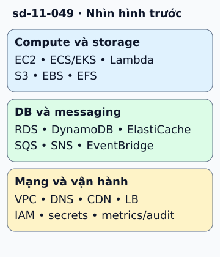

# Bảng tra dịch vụ AWS theo trách nhiệm

Một bản thiết kế cần trả lời “ai làm việc gì” trước khi điền tên AWS. Với compute: EC2 cho VM, ECS/EKS cho các nhu cầu container, Lambda cho function. Với dữ liệu: S3 giữ object, EBS cung cấp block storage, EFS cung cấp file system được quản lý.

**Đọc hình:** Các khung tóm tắt vai trò hoặc lựa chọn để đối chiếu. Các con số và tình huống trong bài là ví dụ minh họa, trừ khi ghi rõ cách tính.

RDS hỗ trợ các engine quan hệ; DynamoDB là DB key-value/document được quản; ElastiCache phục vụ caching. SQS hỗ trợ queue, SNS hỗ trợ pub/sub, EventBridge định tuyến event theo tính năng và cấu hình. Route 53, VPC, CloudFront và các load balancer đảm nhận các vai trò mạng khác nhau.

IAM quản quyền; Secrets Manager phục vụ secrets; CloudWatch và CloudTrail phục vụ các nhu cầu quan sát/audit khác nhau. Sau khi map, ghi vì sao chọn, dữ liệu giữ, quyền tối thiểu, giới hạn và giá. Bài này là bảng tra khi thiết kế, khác bài lộ trình học AWS từng bước.

## Từ viết tắt

- **AWS** (Amazon Web Services) — dịch vụ điện toán đám mây của Amazon; bài tra dịch vụ AWS theo trách nhiệm.
- **EC** (Elastic Compute) — điện toán co giãn: phần chữ cái đầu của EC2, dịch vụ máy ảo của Amazon (tên đầy đủ Elastic Compute Cloud, hai chữ C thành số 2); với compute, EC2 cho VM.
- **VM** (Virtual Machine) — máy ảo: máy tính giả lập chạy bằng phần mềm trên một máy thật; EC2 cho VM.
- **ECS** (Elastic Container Service) — dịch vụ container co giãn của Amazon: chạy và quản lý container; ECS cùng EKS cho các nhu cầu container.
- **EKS** (Elastic Kubernetes Service) — dịch vụ Kubernetes được quản lý của Amazon: chạy và điều phối container; ECS cùng EKS cho các nhu cầu container.
- **EBS** (Elastic Block Store) — kho khối co giãn của Amazon: ổ đĩa ảo gắn vào một máy ảo; EBS cung cấp block storage.
- **EFS** (Elastic File System) — hệ thống tệp co giãn của Amazon: một thư mục chung cho nhiều máy cùng đọc và ghi; EFS cung cấp file system được quản lý.
- **RDS** (Relational Database Service) — dịch vụ cơ sở dữ liệu quan hệ do Amazon vận hành hộ: nhà cung cấp lo máy chủ và sao lưu; RDS thuộc nhóm DB và messaging trong hình.
- **DB** (DataBase) — cơ sở dữ liệu: nơi lưu dữ liệu có tổ chức để ghi và tìm lại; trong hình, nhóm DB và messaging gồm RDS, DynamoDB và ElastiCache.
- **SQS** (Simple Queue Service) — dịch vụ hàng đợi thông điệp của Amazon: nơi bên gửi đặt thông điệp để bên nhận lấy ra xử lý sau; SQS thuộc nhóm messaging trong hình.
- **SNS** (Simple Notification Service) — dịch vụ thông báo đơn giản của Amazon: gửi một thông điệp tới nhiều bên nhận; bài dặn không xem SNS và SQS là cùng mô hình tiêu thụ.
- **VPC** (Virtual Private Cloud) — đám mây riêng ảo: mạng riêng bạn tự chia trong cloud, gồm các subnet, bảng định tuyến và nhóm bảo mật; VPC thuộc nhóm mạng và vận hành trong hình.
- **DNS** (Domain Name System) — hệ thống tên miền: "danh bạ" của Internet, đổi tên miền thành địa chỉ mạng để biết tìm dịch vụ ở đâu; DNS thuộc nhóm mạng và vận hành trong hình.
- **CDN** (Content Delivery Network) — mạng phân phối nội dung: nhiều máy chủ đặt ở nhiều nơi, lưu bản sao nội dung và phát cho người dùng từ máy gần họ; CDN thuộc nhóm mạng và vận hành trong hình.
- **LB** (Load Balancer) — bộ cân bằng tải: máy hoặc phần mềm chia lưu lượng cho nhiều bản sao của cùng một dịch vụ; LB thuộc nhóm mạng và vận hành trong hình.
- **IAM** (Identity and Access Management) — quản lý danh tính và quyền truy cập: cho biết ai là ai và được làm gì với tài nguyên; IAM thuộc nhóm mạng và vận hành trong hình.
- **POSIX** (Portable Operating System Interface X) — chuẩn giao diện cho hệ điều hành kiểu Unix (chữ X gợi nhớ Unix); bài dặn không gọi S3 là ổ đĩa POSIX.

## Nhìn hình thử trả lời

Nhóm worker cần chia việc, mỗi việc giao cho một worker tại một thời điểm theo visibility. Nên xem dịch vụ nào trước?

Xem đáp án

SQS, rồi kiểm delivery, visibility timeout, retry và dead-letter. Consumer vẫn phải xử lý message lặp.

## Giới hạn cần nhớ

Không gọi S3 là ổ đĩa POSIX, không xem SNS và SQS là cùng mô hình tiêu thụ. Managed service vẫn cần cấu hình bảo mật, backup hoặc retention phù hợp.

Xem sâu hơn

Lưu các quyết định vào tài liệu kiến trúc. Đối chiếu quota, Region và yêu cầu mã hóa trước khi đưa bảng tra thành cấu hình production.

## Nguồn đối chiếu

- [Mục chủ đề ByteByteGo tại snapshot cố định](https://github.com/ByteByteGoHq/system-design-101/blob/b28380a4710c5ec9638ec037d4168e288f334cba/data/guides/aws-services-cheat-sheet.md).
- [Overview of Amazon Web Services - Overview of Amazon Web Services](https://docs.aws.amazon.com/whitepapers/latest/aws-overview/introduction.html).
- [Amazon SQS standard queues - Amazon Simple Queue Service](https://docs.aws.amazon.com/AWSSimpleQueueService/latest/SQSDeveloperGuide/standard-queues.html).

Bài giải thích và hình được biên soạn độc lập; không dùng ảnh nguồn. Các tài liệu kỹ thuật trên là điểm đối chiếu cho review, không phải chứng nhận mọi claim đã được kiểm chứng.
