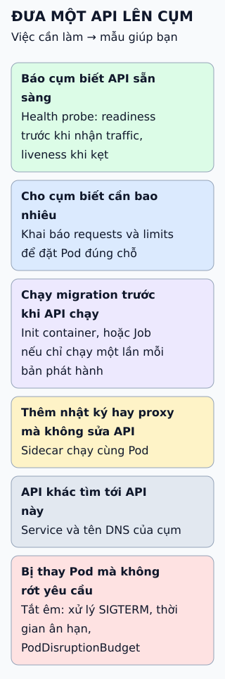

# Mười mẫu thiết kế Kubernetes

Thay vì học thuộc một danh sách, hãy hỏi ứng dụng của bạn đang cần gì ở từng thời điểm: trước khi chạy, lúc đang chạy, khi có dữ liệu riêng, và khi cần tự động hóa.

**Đọc hình:** mũi tên là thứ tự câu hỏi bạn đặt ra khi đưa một ứng dụng lên cụm, không phải thứ tự chạy cố định.

## Nhìn hình thử trả lời

Ứng dụng phải chờ cơ sở dữ liệu sẵn sàng rồi mới nên khởi động, và cụm cần biết khi nào nó sẵn sàng nhận traffic. Hai việc đó dùng mẫu nào?

Xem đáp án

Chờ trước khi khởi động: Init Container (chạy xong mới tới container ứng dụng). Báo sẵn sàng nhận traffic: Health Probe loại readiness.

## Ngộ nhận dễ gặp

Đây là cách sắp xếp của bài này để dễ tìm mẫu theo nhu cầu; tên mười mẫu lấy từ sách Kubernetes Patterns, còn sách có nhiều mẫu khác (ví dụ Daemon Service). Không phải ứng dụng nào cũng cần cả mười: nhiều ứng dụng nhỏ chỉ cần khai báo tài nguyên, probe và Service.

Xem sâu hơn

- **Probe:** liveness (khởi động lại khi kẹt), readiness (có nhận traffic không), startup (cho ứng dụng khởi động chậm).
- **Predictable Demands:** `requests` giúp scheduler đặt Pod; `limits` giới hạn mức dùng tối đa.
- **Sidecar:** các bản Kubernetes gần đây hỗ trợ sidecar dạng gốc, khai báo như init container có `restartPolicy: Always`.
- **Controller** là vòng lặp so trạng thái khai báo với trạng thái thật rồi sửa chênh lệch; **Operator** dùng cùng ý tưởng cho một ứng dụng cụ thể, thường qua CRD.

## Nguồn đối chiếu

- [ByteByteGo tại snapshot cố định](https://github.com/ByteByteGoHq/system-design-101/blob/b28380a4710c5ec9638ec037d4168e288f334cba/data/guides/top-10-k8s-design-patterns.md).
- Sách [Kubernetes Patterns](https://k8spatterns.io/).
- Kubernetes: [probes](https://kubernetes.io/docs/tasks/configure-pod-container/configure-liveness-readiness-startup-probes/), [tài nguyên](https://kubernetes.io/docs/concepts/configuration/manage-resources-containers/), [scheduler](https://kubernetes.io/docs/concepts/scheduling-eviction/kube-scheduler/), [init container](https://kubernetes.io/docs/concepts/workloads/pods/init-containers/), [sidecar](https://kubernetes.io/docs/concepts/workloads/pods/sidecar-containers/), [Job](https://kubernetes.io/docs/concepts/workloads/controllers/job/), [StatefulSet](https://kubernetes.io/docs/concepts/workloads/controllers/statefulset/), [Service](https://kubernetes.io/docs/concepts/services-networking/service/), [controller](https://kubernetes.io/docs/concepts/architecture/controller/), [operator](https://kubernetes.io/docs/concepts/extend-kubernetes/operator/).
