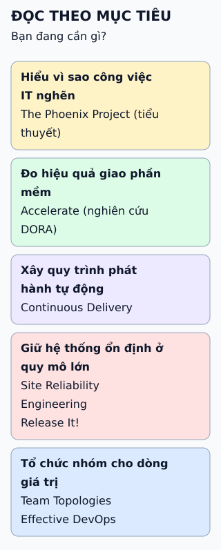

# Sáu cuốn sách DevOps đáng đọc

Chọn sách theo điều bạn đang cần giải quyết, không theo danh sách cố định. Mỗi mục dưới đây là một mục tiêu đọc, kèm cuốn hợp nhất.

**Đọc hình:** mỗi cuốn trả lời một câu hỏi khác nhau; đọc một cuốn theo nhu cầu trước khi đọc thêm.

## Nhìn hình thử trả lời

Nhóm muốn biết việc giao phần mềm của mình đang tốt lên hay tệ đi. Bắt đầu từ cuốn nào, và đo những gì?

Xem đáp án

Accelerate. Nó trình bày bốn thước đo: tần suất triển khai, thời gian từ commit đến chạy thật, tỉ lệ thay đổi gây lỗi và thời gian khôi phục.

## Giới hạn cần nhớ

Sách không chứng minh cách làm hợp với tổ chức của bạn. Nhiều cuốn đã khá cũ: công cụ đã đổi, còn nguyên tắc thì nên chọn lọc. Đọc xong hãy thử nhỏ trước khi áp dụng cho cả nhóm.

Xem sâu hơn

- **The Phoenix Project:** Gene Kim, Kevin Behr, George Spafford. Tiểu thuyết ví công việc IT như dây chuyền sản xuất.
- **Accelerate:** Nicole Forsgren, Jez Humble, Gene Kim.
- **Continuous Delivery:** Jez Humble, David Farley.
- **Site Reliability Engineering:** do nhóm SRE của Google biên tập, đọc trực tuyến miễn phí. **Release It!** của Michael Nygard nói về thiết kế phần mềm chịu lỗi khi chạy thật.
- **Team Topologies:** Matthew Skelton, Manuel Pais. **Effective DevOps:** Jennifer Davis, Ryn Daniels.
- Danh sách này là lựa chọn của bài, rộng hơn nguồn, không phải thứ hạng.

## Nguồn đối chiếu

- [ByteByteGo tại snapshot cố định](https://github.com/ByteByteGoHq/system-design-101/blob/b28380a4710c5ec9638ec037d4168e288f334cba/data/guides/some-devops-books-i-find-enlightening.md).
- Nhóm DORA: [bốn thước đo chính](https://dora.dev/guides/dora-metrics-four-keys/).
- Google: [sách SRE](https://sre.google/sre-book/table-of-contents/).
- Trang sách: [Continuous Delivery](https://continuousdelivery.com/), [Team Topologies](https://teamtopologies.com/), [Release It!](https://pragprog.com/titles/mnee2/release-it-second-edition/).
