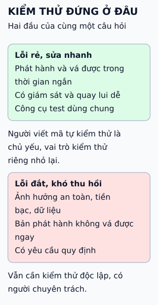

# Tỉ lệ lập trình viên và kiểm thử viên thay đổi thế nào

Khi phát hành nhanh hơn và sửa lỗi rẻ hơn, kiểm thử dịch dần từ một vai trò riêng sang trách nhiệm của người viết mã.

**Đọc hình:** tỉ lệ lấy từ bài của Carlos Arguelles mà nguồn nhắc tới; đó là cách kể xu hướng, không phải thống kê đo được.

## Nhìn hình thử trả lời

Tỉ lệ 100 : 1 có nghĩa là hầu như không còn ai kiểm thử phần mềm?

Xem đáp án

Không. Ý chính là trách nhiệm kiểm thử chuyển sang người viết mã, dựa trên công cụ tự động dùng chung. Việc kiểm thử vẫn diễn ra, chỉ không còn do một nhóm riêng làm hết.

## Giới hạn cần nhớ

Đây là xu hướng ở một số công ty công nghệ lớn, không phải quy luật chung. Phần mềm liên quan đến an toàn hoặc tiền bạc thường vẫn cần kiểm thử độc lập. Các mốc năm và tỉ lệ là ước chừng của tác giả bài gốc.

Xem sâu hơn

- **Vì sao dịch chuyển được:** bản vá tự động và triển khai nhanh làm chi phí sửa lỗi sau phát hành giảm, nên chấp nhận kiểm thử nhanh hơn với rủi ro có kiểm soát.
- **Điều kiện đi kèm:** pipeline tự động, giám sát sau phát hành, khả năng quay lui. Thiếu những thứ này thì bỏ vai trò kiểm thử riêng chỉ chuyển rủi ro sang người dùng.
- **Điều bài không khẳng định:** không nói công ty cụ thể nào nên giảm kiểm thử viên.

## Nguồn đối chiếu

- [ByteByteGo tại snapshot cố định](https://github.com/ByteByteGoHq/system-design-101/blob/b28380a4710c5ec9638ec037d4168e288f334cba/data/guides/paradigm-shift-how-developer-to-tester-ratio-changed-from-11-to-1001.md).
- Bài gốc của tác giả được nguồn nhắc tới: "The Paradigm Shifts with Different Dev:Test Ratios" (Carlos Arguelles). Bài này chưa đọc lại bản đó; số liệu chỉ được dùng như mô tả xu hướng.
