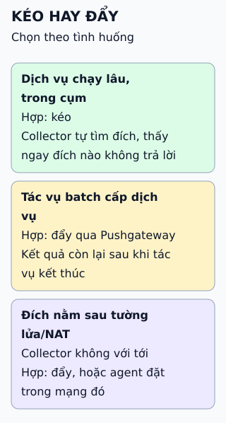

# Thu thập số đo: mô hình kéo (pull)

Trong mô hình kéo, bộ thu thập chủ động hỏi từng dịch vụ số đo hiện tại thay vì chờ dịch vụ gửi tới.

- **Danh sách đích:** nếu ghi cứng vào tệp thì khó theo kịp khi máy chủ thêm bớt liên tục.
- **Service discovery:** Kubernetes, Consul, ZooKeeper... biết ai đang chạy và báo khi thay đổi.
- **Điểm phơi số đo:** thư viện client của dịch vụ mở một địa chỉ HTTP cố định, ví dụ `/metrics`.

## Nhìn hình thử trả lời

Lúc 2 giờ sáng hệ thống tự thêm hai máy chủ. Bộ thu thập kiểu kéo biết kéo thêm hai nơi đó bằng cách nào mà không ai sửa tệp cấu hình?

Xem đáp án

Qua service discovery: bộ thu thập nhận thông báo khi danh sách thay đổi, hoặc hỏi lại định kỳ.

## Đánh đổi cần nhớ

Kéo hay đẩy không có bên thắng tuyệt đối. Kéo dễ biết đích nào đang không trả lời, nhưng khó với tác vụ chạy rất ngắn (kết thúc trước lần kéo kế tiếp) hoặc đích nằm sau tường lửa mà bộ thu thập không chạm tới được.

Xem sâu hơn

- **Prometheus** là ví dụ điển hình của mô hình kéo: cấu hình `scrape_configs`, hỗ trợ nhiều cơ chế service discovery (kể cả Kubernetes).
- **Việc ngắn:** Prometheus có Pushgateway cho tác vụ batch ngắn hạn; tài liệu khuyên chỉ dùng cho trường hợp đó, không thay cho mô hình kéo nói chung.
- **Mô hình đẩy:** agent hoặc ứng dụng gửi số đo tới bộ thu thập; cần kiểm soát tốc độ để tránh làm quá tải bộ thu thập.

## Nguồn đối chiếu

- [ByteByteGo tại snapshot cố định](https://github.com/ByteByteGoHq/system-design-101/blob/b28380a4710c5ec9638ec037d4168e288f334cba/data/guides/push-vs-pull-in-metrics-collecting-systems.md).
- Prometheus: [tổng quan](https://prometheus.io/docs/introduction/overview/), [khi nào dùng Pushgateway](https://prometheus.io/docs/practices/pushing/), [cấu hình scrape](https://prometheus.io/docs/prometheus/latest/configuration/configuration/).
