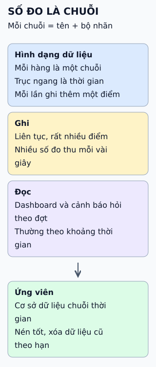

# Chọn cơ sở dữ liệu cho hệ thống số đo

Thay vì hỏi "dùng loại nào", hãy trả lời bốn câu hỏi về dữ liệu của bạn; đáp án sẽ cho thấy kho nào đáng cân nhắc.

**Đọc hình:** câu trả lời chứ không phải tên sản phẩm là thứ quyết định; sản phẩm cụ thể ở phần sâu.

## Nhìn hình thử trả lời

`http_requests{service="a", code="200"}` và `http_requests{service="a", code="500"}` là một hay hai chuỗi?

Xem đáp án

Hai chuỗi. Chuỗi được xác định bởi tên cộng toàn bộ bộ nhãn; đổi giá trị một nhãn là sinh ra chuỗi mới.

## Giới hạn cần nhớ

Chuẩn bị cho số chuỗi quan trọng hơn chọn thương hiệu: nhãn mang giá trị gần như duy nhất (như ID người dùng) làm số chuỗi phình ra, kho nào cũng chậm. Quy mô nhỏ thì một cơ sở dữ liệu đa dụng thiết kế cẩn thận vẫn có thể đủ.

Xem sâu hơn

- **Dữ liệu chuỗi thời gian** là các điểm (thời gian, giá trị) gắn với một chuỗi xác định bởi tên và nhãn. Truy vấn thường là "trong khoảng này, tổng hợp theo nhãn".
- **Kho chuyên dụng** như Prometheus TSDB hay InfluxDB tối ưu việc ghi liên tục, nén và hết hạn dữ liệu. Có sản phẩm thêm khả năng chuỗi thời gian lên cơ sở dữ liệu quan hệ (ví dụ TimescaleDB trên PostgreSQL).
- **Cơ sở dữ liệu đa dụng:** làm được khi tải vừa phải, nhưng truy vấn cửa sổ thời gian dài dòng hơn và phải tự tinh chỉnh chỉ mục, phân vùng.
- **Cách kiểm tra:** thử với tải ghi và truy vấn gần thật trước khi chốt.

## Nguồn đối chiếu

- [ByteByteGo tại snapshot cố định](https://github.com/ByteByteGoHq/system-design-101/blob/b28380a4710c5ec9638ec037d4168e288f334cba/data/guides/choose-the-right-database-for-metric-collecting-system.md).
- Prometheus: [mô hình dữ liệu](https://prometheus.io/docs/concepts/data_model/), [đặt tên và nhãn](https://prometheus.io/docs/practices/naming/).
- InfluxDB: [tài liệu](https://docs.influxdata.com/); Timescale: [tài liệu](https://docs.timescale.com/).
