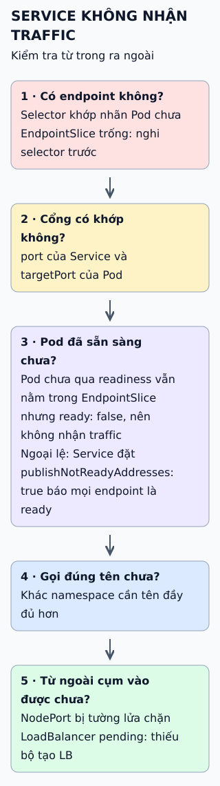

# Bốn loại Service trong Kubernetes

Chọn loại Service bằng cách hỏi ai cần gọi tới nó. Bốn câu trả lời ứng với bốn giá trị của trường `type`.

**Đọc hình:** ba loại đầu mở rộng phạm vi truy cập; loại cuối đi ngược chiều, từ trong cụm ra ngoài.

## Nhìn hình thử trả lời

Ứng dụng trong cụm gọi `db`, còn cơ sở dữ liệu thật ở `db.example.com` bên ngoài. Loại nào hợp, và Service có tạo IP trong cụm không?

Xem đáp án

ExternalName. Nó làm DNS trả về bản ghi CNAME tới tên ngoài, không cấp ClusterIP và không chuyển tiếp traffic.

## Giới hạn cần nhớ

Service chỉ cho địa chỉ ổn định và cân bằng ở tầng 4. Định tuyến HTTP theo đường dẫn hay tên miền thuộc về Ingress hoặc Gateway, không phải một loại Service.

Xem sâu hơn

- **ClusterIP** là mặc định nếu không ghi `type`; chỉ truy cập được từ trong cụm.
- **NodePort:** theo mặc định cổng nằm trong dải 30000–32767 và mở trên mọi node.
- **LoadBalancer:** bộ cân bằng tải do nhà cung cấp cloud hoặc một thành phần bổ sung tạo; thường dựng trên ClusterIP và NodePort.
- **ExternalName:** không dùng selector; với giao thức dựa trên tên máy như HTTP/HTTPS cần chú ý vì tên đích khác tên được gọi.

## Nguồn đối chiếu

- [ByteByteGo tại snapshot cố định](https://github.com/ByteByteGoHq/system-design-101/blob/b28380a4710c5ec9638ec037d4168e288f334cba/data/guides/top-4-kubernetes-service-types-in-one-diagram.md).
- Kubernetes: [Service](https://kubernetes.io/docs/concepts/services-networking/service/).
