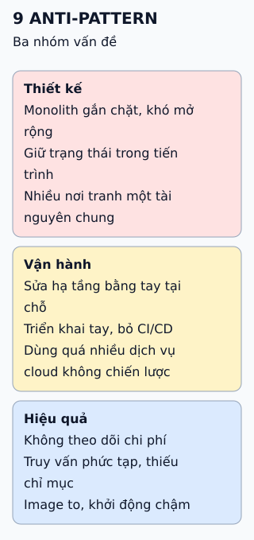

# Chín anti-pattern khi làm ứng dụng cloud-native

Thay vì học thuộc một danh sách lỗi, hãy đi theo bốn tình huống khó chịu: mỗi tình huống lộ ra một nhóm thiết kế sai.

**Đọc hình:** chín lỗi nằm rải trong bốn tình huống; một lỗi có thể xuất hiện ở nhiều tình huống.

## Nhìn hình thử trả lời

Một tiến trình giữ giỏ hàng của người dùng trong bộ nhớ. Vì sao điều đó cản trở việc nhân bản?

Xem đáp án

Người dùng có thể bị chuyển sang bản sao khác không có giỏ hàng của họ, hoặc mất khi tiến trình khởi động lại. Nên đưa trạng thái ra dịch vụ lưu trữ chung.

## Giới hạn cần nhớ

"Anti-pattern" phụ thuộc bối cảnh. Monolith chia module rõ ràng vẫn hợp lý cho nhiều nhóm; tránh trạng thái trong tiến trình không có nghĩa hệ thống không có trạng thái, mà là đẩy nó vào chỗ quản lý đúng cách.

Xem sâu hơn

- **Hạ tầng bất biến:** tạo bản mới từ định nghĩa rồi thay thế, thay vì sửa tại chỗ, để tránh cấu hình lệch giữa các máy.
- **Không trạng thái:** tiến trình dễ khởi động lại và nhân bản khi dữ liệu bền nằm ở dịch vụ lưu trữ.
- **Image nhỏ:** build nhiều giai đoạn giúp kéo và khởi động nhanh hơn.
- **Chi phí:** gắn nhãn tài nguyên và theo dõi theo nhóm giúp thấy ngay khoản tăng bất thường.

## Nguồn đối chiếu

- [ByteByteGo tại snapshot cố định](https://github.com/ByteByteGoHq/system-design-101/blob/b28380a4710c5ec9638ec037d4168e288f334cba/data/guides/cloud-native-anti-patterns.md).
- [The Twelve-Factor App](https://12factor.net/).
- Martin Fowler: [ImmutableServer](https://martinfowler.com/bliki/ImmutableServer.html).
- AWS: [trụ cột tối ưu chi phí](https://docs.aws.amazon.com/wellarchitected/latest/cost-optimization-pillar/welcome.html).
