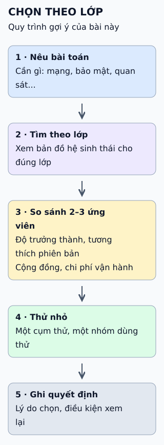

# Chọn công cụ Kubernetes theo lớp

Hệ sinh thái Kubernetes có quá nhiều công cụ. Cách đỡ rối là chọn theo lớp việc cần giải quyết, rồi so sánh từng ứng viên.

**Đọc hình:** năm bước do bài này đề xuất để dùng bản đồ công cụ; bản đồ gốc chỉ là hình minh họa các công cụ.

## Từ viết tắt

- **CNCF** (Cloud Native Computing Foundation) — quỹ bảo trợ các dự án điện toán đám mây nguyên bản; bài dùng mức trưởng thành của dự án do quỹ này phân (sandbox, incubating, graduated) để đối chiếu.

## Nhìn hình thử trả lời

Một dự án đã ở mức "graduated" của CNCF (Cloud Native Computing Foundation — quỹ bảo trợ các dự án điện toán đám mây nguyên bản như Kubernetes). Có nghĩa là nó luôn phù hợp với hệ thống của bạn?

Xem đáp án

Không. Mức trưởng thành cho biết dự án ổn định và có quản trị tốt, nhưng bạn vẫn cần xét bài toán, phiên bản Kubernetes đang chạy và sức người vận hành.

## Giới hạn cần nhớ

Một bản đồ công cụ chỉ cho thấy có gì, không nói công cụ nào hợp với bạn, và nhanh cũ vì dự án thay đổi liên tục. Ít công cụ thường dễ vận hành hơn nhiều công cụ.

Xem sâu hơn

- **CNCF** phân dự án theo ba mức: sandbox, incubating, graduated.
- **Tương thích:** kiểm tra phiên bản Kubernetes được công cụ hỗ trợ trước khi nâng cấp cụm.
- **Chi phí ẩn:** mỗi công cụ thêm là một thứ cần nâng cấp, vá lỗi, theo dõi và dạy người mới.

## Nguồn đối chiếu

- [ByteByteGo tại snapshot cố định](https://github.com/ByteByteGoHq/system-design-101/blob/b28380a4710c5ec9638ec037d4168e288f334cba/data/guides/kubernetes-tools-stack-wheel.md).
- CNCF: [danh sách dự án và mức trưởng thành](https://www.cncf.io/projects/), [Landscape](https://landscape.cncf.io/).
