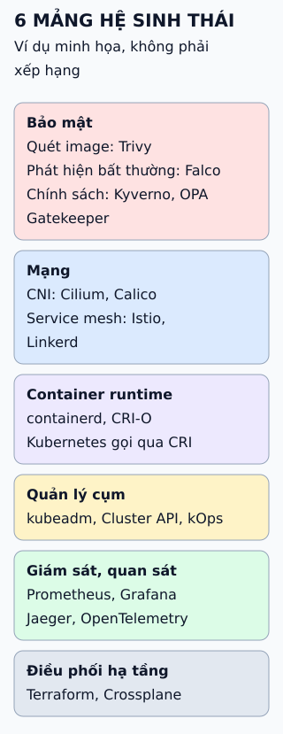

# Hệ sinh thái Kubernetes theo đường đi của một ứng dụng

Đi theo đường đi một ứng dụng từ mã đến chạy thật, bạn sẽ thấy mỗi chặng cần loại công cụ nào. Tên công cụ chỉ là ví dụ.

**Đọc hình:** thứ tự là đường đi của ứng dụng; chặng 5 chạy suốt đời ứng dụng, không chỉ sau cùng.

## Nhìn hình thử trả lời

Từ Kubernetes 1.24, cụm còn chạy được image tạo bằng Docker không?

Xem đáp án

Có. Image Docker theo chuẩn OCI nên containerd hoặc CRI-O chạy được. Thứ bị gỡ là dockershim, lớp cho phép kubelet dùng Docker Engine trực tiếp.

## Giới hạn cần nhớ

Công cụ chồng lấn giữa các chặng (service mesh vừa là mạng vừa liên quan bảo mật) và danh sách ví dụ không đầy đủ, không phải khuyến nghị.

Xem sâu hơn

- **CRI** là giao diện kubelet dùng để nói chuyện với runtime; **CNI** là chuẩn cắm plugin mạng.
- **Hạ tầng vs cụm:** Terraform hay Crossplane khai báo tài nguyên cloud (máy, mạng, cơ sở dữ liệu); kubeadm hay Cluster API dựng và nâng cấp cụm.
- **GitOps:** Argo CD đồng bộ trạng thái cụm từ kho Git.

## Nguồn đối chiếu

- [ByteByteGo tại snapshot cố định](https://github.com/ByteByteGoHq/system-design-101/blob/b28380a4710c5ec9638ec037d4168e288f334cba/data/guides/kubernetes-tools-ecosystem.md).
- Kubernetes: [container runtime](https://kubernetes.io/docs/setup/production-environment/container-runtimes/), [Dockershim FAQ](https://kubernetes.io/blog/2022/02/17/dockershim-faq/).
- CNCF [Landscape](https://landscape.cncf.io/).
