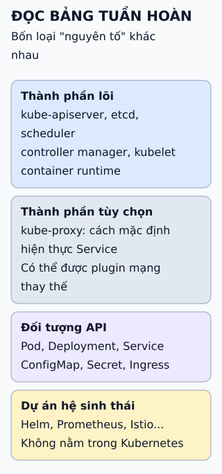

# Bảng tuần hoàn Kubernetes: đọc để tra cứu

Một bảng tuần hoàn gom rất nhiều thành phần vào một trang. Đọc nó như bản đồ tra cứu, không phải danh sách để học thuộc.

**Đọc hình:** các loại này hay bị lẫn trên một bảng; tách ra giúp biết cái nào đi kèm cụm, cái nào tùy chọn, cái nào phải tự cài.

## Từ viết tắt

- **API** (Application Programming Interface) — giao diện lập trình ứng dụng: cách để một chương trình gọi chức năng hoặc lấy dữ liệu của chương trình khác theo quy ước đã định.

## Nhìn hình thử trả lời

Helm có phải thành phần lõi của Kubernetes không?

Xem đáp án

Không. Helm là công cụ đóng gói riêng, thuộc hệ sinh thái; cụm Kubernetes chạy được mà không cần Helm.

## Giới hạn cần nhớ

Một bảng một trang không cho biết thành phần nào đang được duy trì tốt hay phù hợp với bạn, và nhanh lỗi thời. Nguồn nói bảng bao quát 120 thành phần; bài này không liệt kê lại con số đó.

Xem sâu hơn

- **Cách tra:** tìm theo bài toán trước (ví dụ "lưu nhật ký"), rồi mở tài liệu của dự án.
- **Phân biệt:** thành phần lõi là thứ cụm cần để chạy; thành phần tùy chọn như kube-proxy có mặc định nhưng có thể thay bằng giải pháp khác (một số plugin mạng tự lo việc chuyển traffic cho Service); đối tượng API (Application Programming Interface — giao diện lập trình ứng dụng) là thứ bạn khai báo; dự án hệ sinh thái là thứ bạn chọn thêm.
- **Làm quen từng bước:** nắm lõi và đối tượng API trước, hệ sinh thái sau.

## Nguồn đối chiếu

- [ByteByteGo tại snapshot cố định](https://github.com/ByteByteGoHq/system-design-101/blob/b28380a4710c5ec9638ec037d4168e288f334cba/data/guides/kubernetes-periodic-table.md).
- Kubernetes: [thành phần cụm](https://kubernetes.io/docs/concepts/overview/components/).
- Helm: [tài liệu](https://helm.sh/docs/).
