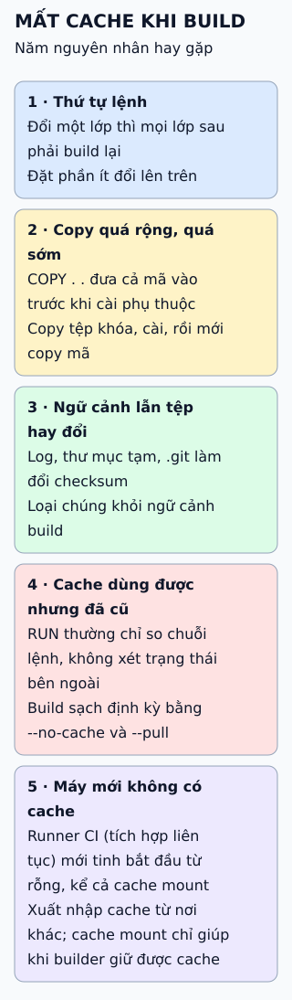

# Chín thực hành tốt khi viết Dockerfile

Nhìn từ vấn đề bạn gặp: build chậm, image to, không tái lập được, và rủi ro bảo mật. Mỗi vấn đề có cách xử lý trong Dockerfile.



**Đọc hình:** chín thực hành nằm trong năm vấn đề này; tìm vấn đề của bạn trước.

## Nhìn hình thử trả lời

Bạn sửa một dòng mã nguồn nhưng không đổi danh sách phụ thuộc. Vì sao bước cài phụ thuộc không phải chạy lại nếu sắp lớp đúng?

<details>
<summary>Xem đáp án</summary>

Lớp sao chép danh sách phụ thuộc không đổi nên Docker dùng lại cache; chỉ các lớp từ bước sao chép mã nguồn trở đi chạy lại.

</details>

## Giới hạn cần nhớ

Thẻ phiên bản (tag) không bất biến: người duy trì có thể đẩy lại cùng tag, nên cần tái lập chính xác thì ghim digest. Image "chính thức" cũng không có nghĩa không có lỗ hổng, nên vẫn phải quét.

<details>
<summary>Xem sâu hơn</summary>

```dockerfile
FROM node:22-alpine AS build
WORKDIR /app
COPY package*.json ./
RUN npm ci
COPY . .
RUN npm run build

FROM node:22-alpine
WORKDIR /app
COPY package*.json ./
RUN npm ci --omit=dev
COPY --from=build /app/dist ./dist
USER node
CMD ["node", "dist/server.js"]
```

- **Nhiều giai đoạn:** công cụ build chỉ nằm ở giai đoạn đầu nên image cuối nhỏ hơn.
- **`.dockerignore`:** loại `.git`, `node_modules`, tệp tạm khỏi ngữ cảnh build.
- **Nhãn:** dùng khóa chuẩn như `org.opencontainers.image.source`.

</details>

## Nguồn đối chiếu

- [ByteByteGo tại snapshot cố định](https://github.com/ByteByteGoHq/system-design-101/blob/b28380a4710c5ec9638ec037d4168e288f334cba/data/guides/9-docker-best-practices-you-must-know.md).
- Docker: [best practices](https://docs.docker.com/build/building/best-practices/), [multi-stage](https://docs.docker.com/build/building/multi-stage/), [cache](https://docs.docker.com/build/cache/).
